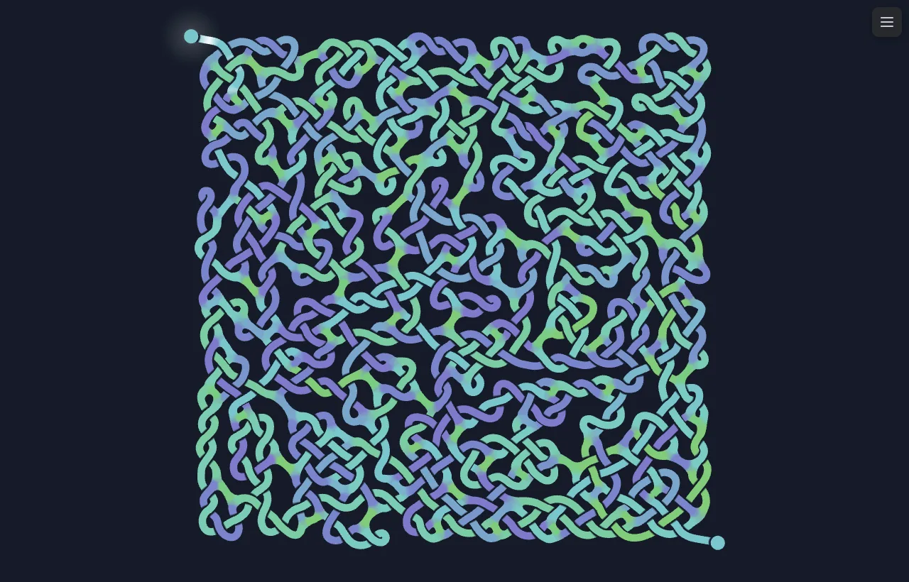

# Knotmaze

Procedurally generated Celtic-knot mazes that you can solve, tug, and play
like an instrument.

**Play it: [levi.dev/knotmaze](https://levi.dev/knotmaze/)**
(also at [knotmaze.pages.dev](https://knotmaze.pages.dev/))



Every maze is woven from threads that over- and under-cross like a Celtic
knot, and the threads themselves are the paths. Find your way from the
glowing entrance at one corner to the exit at the other by choosing which
thread to follow at each junction.

## Features

- **Generated knotwork.** A lattice grower lays out the knot, and live
  physics relaxes its zigzags into smooth, evenly spaced curves.
- **Real threads.** Every thread is a simulated string. Crossings slide
  along the threads, and over/under order is kept in a quasi-3D depth model.
  Drag a thread and the knot tugs back.
- **Maze mode.** Thread splices form 3-way and 4-way junctions. You tap a
  branch to travel the next stretch of thread, and re-tap the last one to
  back up. The game tracks your path length against the optimal route, plus
  how far you backtracked.
- **An instrument.** Each thread section is tuned by its length. Pluck one
  and it rings. In music mode the knot plays a song, one plucked thread per
  note.
- **Looks.** Color schemes (mono, per-thread, distance gradient, random
  sections, noise), animated intros (trace, bloom, draw, ink, with burn,
  roots, rainbow, comet and dust effects), shaped mazes (heart, star, fish,
  tree, ring), fog of war, and an Ariadne's-thread mode that leaves a yarn
  behind you.
- **Shareable links.** The URL holds the whole design: the seed plus any
  settings you changed. A link reproduces exactly the maze you see.

## Controls

| Action | Mouse / trackpad | Touch |
| --- | --- | --- |
| Move along a branch | Click a highlighted branch | Tap a highlighted branch |
| Back up | Click the last branch again | Tap it again |
| Pluck a thread | Click any other thread | Tap any other thread |
| Tug a thread | Drag it; it rings when you let go | Same |
| Zoom | Mouse wheel, or trackpad pinch | Pinch |
| Pan | Drag empty space, middle-drag, or two-finger scroll | Drag empty space, or two fingers |
| Reset the view | Double-click empty space | Double-tap empty space |

The ☰ button opens the settings panel. Hover a setting to see what it does.
Its reset glyph restores the default.

Sound starts after your first click, tap or key press, because browsers
don't allow audio before then.

## How it works

The generator has three layers:

1. **Combinatorial.** A planar tangle graph on a lattice holds crossing,
   junction and end nodes. The maze is planned over it: splices, merges, dead
   ends, and the entrance and exit cuts.
2. **Geometric.** Centripetal Catmull-Rom splines run through the lattice
   points, with arc-length parameterization.
3. **Dynamic.** Position-based Verlet physics treats each thread as a chain
   with springs, bending and repulsion. Crossings are sliding bindings with
   static and kinetic friction. Collision runs as 3D capsule tests against a
   depth that follows the over/under diagram.

Rendering uses [PixiJS](https://pixijs.com/) v8 with custom WebGL2 shaders:
ribbon meshes, a per-pixel color field where threads join, and particle
effects. Audio is a Web Audio `AudioWorklet` string model (extended
Karplus-Strong). The settings panel is [Tweakpane](https://tweakpane.github.io/docs/).

Everything is deterministic from the seed, so the same link always builds
the same maze.

## Development

Requires Node.js and npm.

```sh
npm install
npm run dev      # Vite dev server at http://localhost:5173
npm test         # Vitest suite
npm run build    # Production build into dist/
```

Every push to `master` runs the test suite, then deploys `dist/` to
Cloudflare Pages. A failing suite leaves the previous deployment live.

```
src/
  core/       tangle graph, lattice growth, maze planning, walk graph,
              section colors, reveal plans, shapes
  geometry/   spline sampling
  physics/    particle system and constraint forces
  game/       maze solving state and metrics
  render/     ribbon renderer, meshes, junction field, appearance effects
  audio/      string synth, pitch assignment, songs
  ui/         settings panel, URL state
test/         Vitest suites, mirroring src/
```

## Credits

Made by [Snoring Cat](https://snoringcat.games) (Levi Lindsey).
