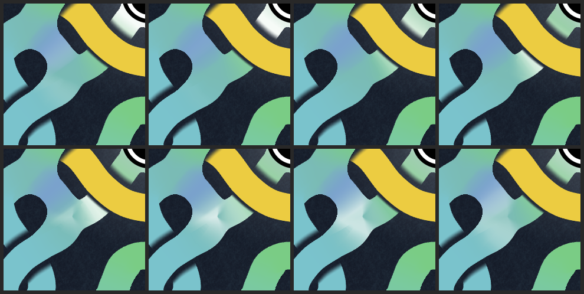
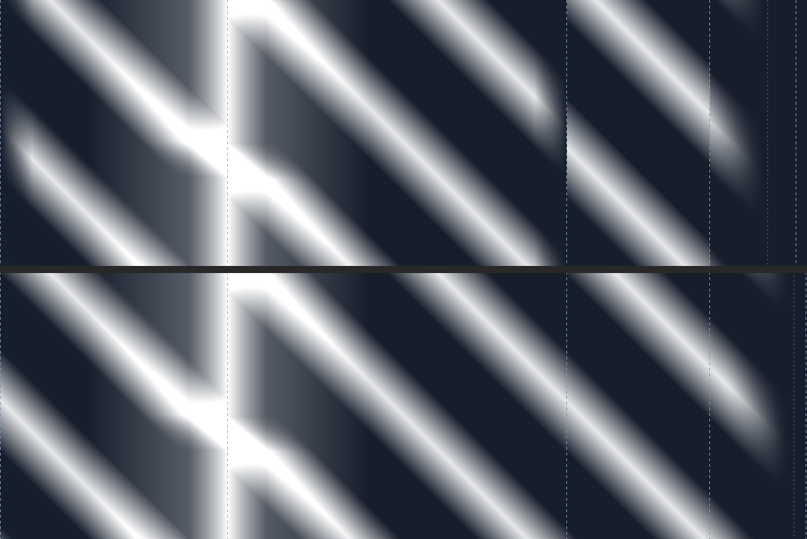
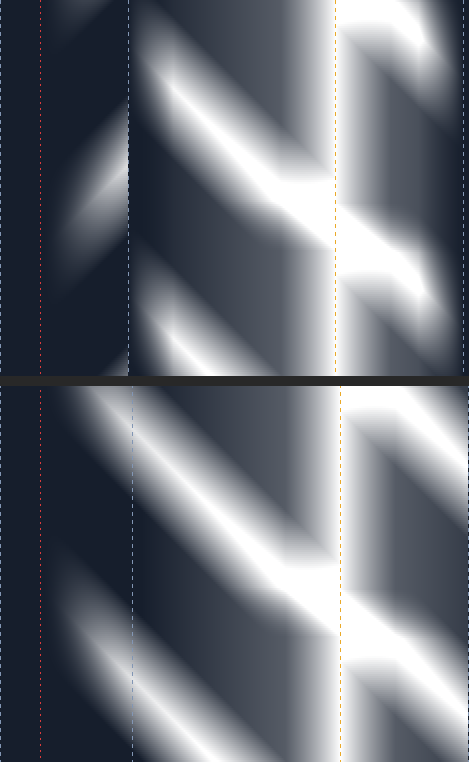
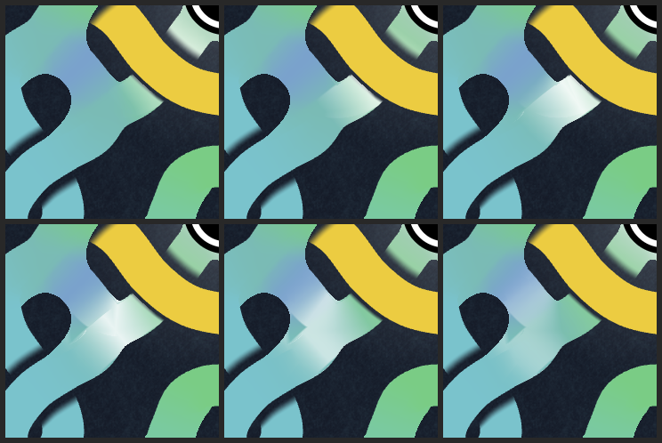
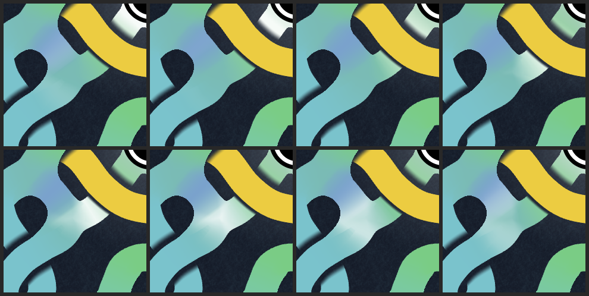
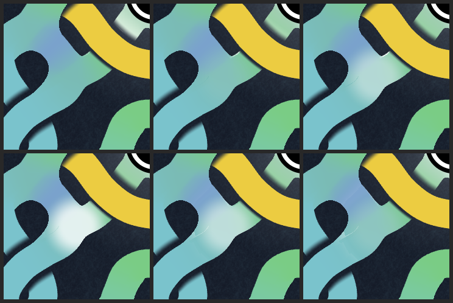
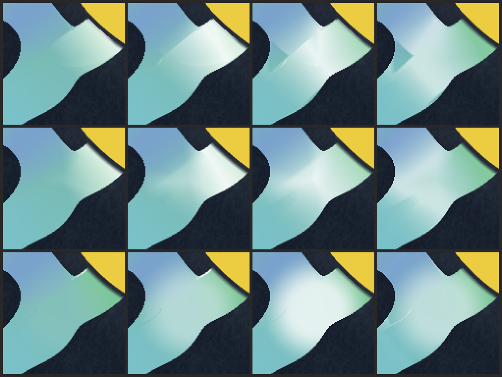
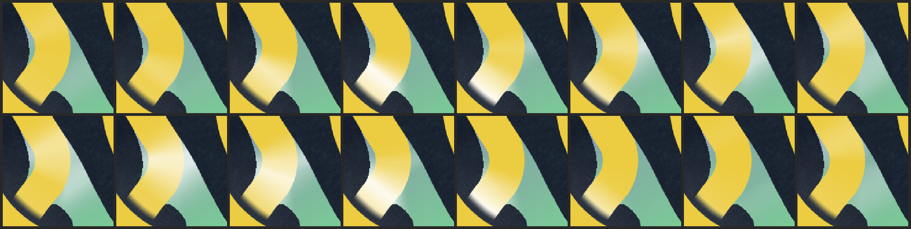
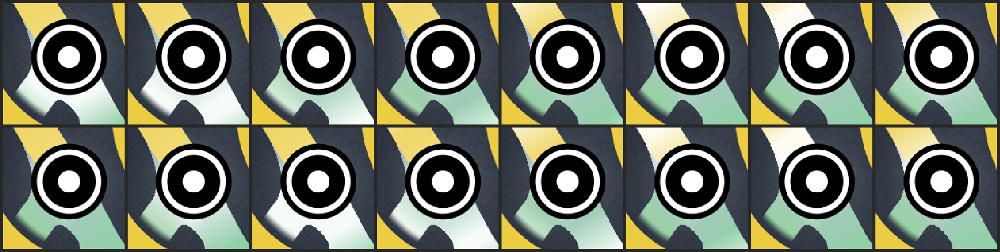

# K1139: choice pulses across junctions (stage 1, the plan)

Levi, 2026-11-03: "Pulse reach is good. BUT, we have to make pulses
animate correctly across junctions. This will be important to get right,
so take some time to properly plan what this should look like, how to
verify it, and how to implement it."

Stage 1 is planning only: no `src/` change. Probes, harnesses and
pictures are in `.claude/probes/K1139/` (the scripts and the pictures
below are committed with `git add -f`; the bulk output is not). Brief:
`docs/design/K1139_s1_brief.md`. History of the pulses:
`docs/design/K299_choice_pulse_bug.md`, ledger K175, K189, K299.

## Summary

- **What is wrong today** (section 1). Where a lit arm meets the next
  junction, the crest dims into the junction and the arms beyond light
  up at full strength (a notch, then a pop), at a phase that jumps by
  the difference between the arm's lattice length and its drawn length.
  Inside the junction's fan the crest is drawn as straight bars cut by
  angle, not as light that follows the paths. Behind you, the light is
  born at the junction you came from and runs both ways. Measured on
  the CPU mirror at every lit junction boundary: brightness jumps of
  0.86-1.00 (of a full crest) where your choices end, 0.18-0.32 where
  the arms beyond them end (table 1.4).
- **The fix, part one** (section 2.1, stage S2): one light field over
  the lit tree, its distance summed from the drawn lengths, carried
  through every junction, flowing toward you behind you. On the same
  real stands the CPU mirror then reads 0.000-0.001 at every boundary,
  and a prototype of it injected into the live renderer (a probe, no
  `src/` change) draws the frames in 2.3.
- **The fix, part two** (2.2, stage S3): through the fan the crest
  splits and follows each way on, along the same curves the gold path
  draws (K81's route bands). Recommended look: **A**.
- **Verification** (section 4): a pure `pulse_path` model with unit
  tests, probe tables at pinned clock times on five named stands,
  kymographs and frame strips.
- **Stages** (section 5): S2 model (no phone), S3a band geometry (no
  phone), S3b the fan shader (**phone**), S4 loops and cycles (phone,
  batched with S3b), S5 your own junction (only if Q3 says so), S6 the
  route pulse for K1140 (a light phone look).
- **Questions for Levi** (section 6): how the light passes a fork (Q1),
  which way it runs behind you (Q2), and at your own junction (Q3).

## 1. Today

### 1.1 How a pulse is made

The declaration is built in `src/render/fabric_maze_renderer.ts`
(about lines 4015-4088) and handed to the ribbon renderer as
`setPaint(spans, pulses, caps, routes, traveled)`. A pulse item is
`{chain, cJunction, cFar, inward, hovered, dist0, cont}`: one walk edge,
its junction end and far end in control coordinates, the flow
direction, the distance of its junction end from you (`dist0`) and
whether the light carries on past its far end (`cont`).

- **Your junction's arms** come from `controller.choices()`, plus the
  arrival (the arm you came by) as an inward item. None of them carries
  `dist0` or `cont`.
- **Beyond your junction**, `litArms` (`src/game/route_plan.ts:295`)
  runs a Dijkstra from your junction over the walk graph's LATTICE
  lengths (`e.length`; its comment says "world arc", which is wrong),
  emits each edge once from its nearer end with `dist0` = that end's
  lattice distance, `inward` false, and `cont = nd < reach && far &&
  !far.isEnd`.
- A change of `pulseKey` (`pulses[0].chain:round(cJunction*4)`) resets
  `pulseBorn`, the 0.45 s fade-in. A move silences the pulses (K175).

### 1.2 How a pulse is drawn

**On a ribbon**, `kPulseV` (`src/render/paint_math.ts` about 1456-1480,
its GLSL twin in `paint_glsl.ts`) gives the brightness at arc `d` (world)
from the item's junction end:

```
if (d < 0 || d > span) return 0;   dG = dist0 + d
endWin = cont ? 1 : clamp((span - d) / PULSE_END_WINDOW 0.45)
raw = inward ? dG + travelIn : dG - travelOut;  ph = raw mod s
dist = min(ph, s - ph);  dC = the crest's own distance from you
bump = max(0, 1 - dist / CREST_WIDTH 0.72) * min(1, dC / CREST_RAMP 0.5)
floor = (0.38 + 0.62 * max(0, 1 - dG / 0.55)) * max(0, 1 - dG / 2.0)
v = min(1, (floor + 0.9 * bump) * endWin) * fadeIn * reachWin(dG)
```

`reachWin` fades the last `min(1, reach / 2)` before the reach.
`src/render/ribbon/paint_state.ts:834-839` sets the clocks:
`travelIn = (t * 1.6) mod s`, `travelOut = ((t + PULSE_OUT_LEAD 0.3) *
1.6) mod s`, spacing `s` = 2.5, so crests run at 1.6 world/s, one every
1.5625 s, and the outward crests lead the inward ones by 0.3 s (0.48
world).

**In a junction's fan**, the base colour comes from the arms' material
strips (`src/render/arm_strip.ts`): the fan shader
(`src/render/junction_field.ts`) reads the two arms bracketing the
pixel's angle at arc `profArc(rho * cos(rel))` and blends them by angle.
Each arm's crest is therefore projected radially into the fan and
cross-faded with its neighbour's: bars cut by angle, which do not follow
the fan's curves. K81's route bands (`src/render/junction_routes.ts`)
draw the gold path through a fan as polylines `(x, y, tau, free)`, up to
`MAX_ROUTES` = 4 per record (`junction_field.ts:106`, the loop at :312);
routed records keep composed and untraveled rows.

### 1.3 What goes wrong at a junction

| | What the eye sees | Where | Cause |
|---|---|---|---|
| a | **Notch, then pop.** The crest dims as it runs into the next junction, and the arms beyond light up at full strength. | Every junction one of your choices leads to (inside the reach). | Your choices carry no `cont`, so the end window fades the last 0.45 world of each; the arms beyond start at full strength. |
| b | **Phase step.** The crest on the far side is not where the near side's crest went in: it jumps ahead or back. | Every lit junction; small at reach 3, large at big reach and long arms. | `dist0` is a lattice length, `d` a drawn (world) length. On k111 at reach 3 the difference is 0.03-0.05 world (e150 2.121 lattice / 2.075 drawn); at reach 8 it is 0.10-0.34 at x4's junctions, and long arms differ by 0.4-1.3 (e246 0.76, e199 0.55, e83 0.38 = 10.6%). |
| c | **Bars in the fan.** Even with a and b fixed, the crest crosses the fan as straight bars: a chevron in the wedge between the arms beyond, a torn crest beside the arm it came from. | Inside every lit fan. | The fan blends the arms' radial crests by angle (1.2). |
| d | **A hand-off at your junction.** The outgoing crests leave a moment before the incoming crest arrives, and both are dim within half a unit of you. | Your junction only. | `PULSE_OUT_LEAD` 0.3 s and `CREST_RAMP` 0.5; deliberate, no rationale found in K175/K189/K299. Q3. |
| e | Pulses stop during a move and fade in after it. | Every move. | K175; out of scope, unchanged. |
| f | **The junction behind you is a source.** Light runs in toward you along the arm you came by, but away from that junction along the arms beyond it, so it is born there and runs both ways. | The previous junction's other arms. | The arrival is inward, `litArms` emits everything else outward. Q2. |
| g | A loop that leaves and re-enters one junction gets two items over one range; the last one wins (a crest can run backwards or double). | Self-loops in the reach. | Each end emits the edge. |
| h | An arm lit from both ends (it closes a cycle) shows a seam or a notch at its far end. | Cycle-closing arms in the reach. | Emitted once from the nearer end; the other side's light meets it at a different distance. |

### 1.4 Measured: the boundary table

`table.mjs` runs the CPU mirror (`kymo.mjs`'s `pulseV`, a line-for-line
port of `kPulseV`) on the declared items of each stand, at 64 clock
times over one period, and reads every boundary where a lit arm P hands
its light to a lit arm Q: the phase step `Q.dist0 - (P.dist0 + P.span)`,
P's `cont`, and the largest brightness jump across the junction. "S2"
is the stage-2 model of 2.1, injected (`K1139_INJECT=fixed`).

| Stand | Boundary | Today: step, cont, max jump | S2: step, cont, max jump |
|---|---|---|---|
| cross | e150 -> e21, e151 at mnode_48 | 0.047, 0, **0.863** | 0.000, 1, 0.001 |
| four | e135 -> e18, e136 at mnode_27 | 0.104, 0, **0.863** | 0.000, 1, 0.000 |
| src | e21 -> e157, e158 at mnode_49 | -0.029, 0, **1.000** | 0.000, 1, 0.000 |
| x4 | e176 -> e134, e135, e175 at node_378 (4 arms) | 0.271, 0, **0.882** | 0.000, 1, 0.000 |
| x4 | e177 -> e79, e178 at node_386 | 0.339, 0, **0.882** | 0.000, 1, 0.000 |
| x4 | e135 -> e18, e136 at mnode_27 | 0.104, 1, 0.182 | 0.000, 1, 0.000 |
| x4 | e140 -> e95, e139 at node_714 | 0.258, 1, 0.322 | (behind you: inward) |

Behind you (src: node_116; x4: mnode_171) today's arms beyond the
previous junction run OUTWARD, with `dist0` 2.121 against the arrival's
drawn 2.075 (x4: 3.536 against 3.211); under S2 they run inward with
`dist0` equal to the arrival's drawn length.

### 1.5 Pictures

All frames: 960x630 at 60 px per world unit, dsf 1.5, clocks pinned at
`t = 100 + k * 1.5625 / 8` (k = 0..7, one period), the knot asleep,
`phw=0` (the same state every load). Strips are 2x4, row-major, frames
0-7, each a 240x240 crop around the junction named.

**How to read a kymograph** (`kymo_*.png`): distance along a path left to
right (0.01 world per column), time down (1.5 periods, 1/80 s per row);
a crest is a bright diagonal stripe; dotted vertical lines are
junctions (amber: yours), the red dotted line is the reach. A pulse that
carries through a junction is one straight stripe across its line. Top
panel today, bottom panel S2.

- `strip_cross_today.png` (mnode_48, a plain 3-arm junction one of your
  choices reaches): frames 4-5 show the dark notch at the fan's entrance,
  then the two arms beyond light at once (a, c).
  
- `kymo_x4.png` (path e180 -> you -> e176 -> node_378 -> e135 ->
  mnode_27 -> e18, reach 8): top, the stripes fade before node_378 and
  restart displaced after it, and step again at mnode_27 (a, b); bottom,
  straight stripes through both.
  
- `kymo_src.png` (e198 -> node_116 -> e150 -> you -> e21): top, the
  stripes on e198 lean the other way: the light leaves node_116 in both
  directions (f); bottom, one direction throughout.
  
- Also made, kept local (untracked, to keep the repo small; the
  appendix's commands rebuild them): `strip_fork_today.png` (a plain fork
  at your junction, node_12: only the hand-off d shows at reach 3),
  `strip_four_today.png` (you on the 4-arm node_378), `strip_x4_today.png`
  (node_378 lit from e176 at reach 8), `strip_src_today.png` (node_116
  behind you), `kymo_cross.png`, `kymo_four.png`.

## 2. The look

### 2.1 One light field (every option shares it; stage S2)

The lit arms form a tree rooted at you. Build it with a Dijkstra over
LATTICE lengths (stable: the tree does not flip while the knot moves),
then give every arm `dist0` = the sum of the live DRAWN spans along the
tree from you to its junction end, quantized to 1e-3 so the declaration
only changes when the geometry really moves. Then:

- every arm whose far end is a junction inside the reach carries
  `cont`, your choices included: no fade before a junction (fixes a);
- the next arm starts exactly where the last one ended (fixes b);
- behind you (everything reached through the arm you came by) the light
  runs INWARD: it gathers at the previous junction and flows on toward
  you, so the light runs one way everywhere: from behind you, through
  you, out along your choices (fixes f; Q2);
- an arm lit from both ends takes the nearer distance at every point,
  `dG = min(dA + d, dB + W - d)`: the two sides' light meets at a ridge
  inside the arm, softened by a short fade (fixes h, stage S4);
- a self-loop is one item (fixes g, S4).

With this alone the fan keeps its bars: that is option B.

### 2.2 Option A: the light splits along the paths (recommended)

The crest comes down the arm, enters the junction and divides: one copy
follows each way on, curving with the fan along the same curve the gold
path draws when you walk that way, and arrives at the start of each next
arm exactly as that arm's own crest begins. The copies keep the crest's
length (measured along each curve), the ribbon's width and the arms'
brightness; where the copies still overlap near the arm they came from,
they carry the same crest, so they do not add up. Speed is 1.6 world/s
along each curve; a curve whose length differs from the arms' distance
across the fan runs a little faster or slower inside the fan only (P3
bounds it).

Mechanism (S3): at each lit junction, a pulse band (K81's band builder)
from the parent arm to each child arm (3 arms: 2 bands; 4 arms: 3),
sharing the 4 band slots with the gold path; behind you the bands run
from each back arm into the arrival, and the one the path took is the
gold band itself. The fan shader evaluates the crest analytically on the
band at `dG = D_J + tau` (tau the band's arc, rescaled so both ends meet
the arms' distances); `D_J` and the inward flag ride in the band
vertex's free 4th component or the record header. A banded record reads
its arms' strips in a quiet mode (no gold, no crest; floor and hover
kept), so the bars of 1.2 do not paint underneath.



`mock_A_cross.png`: frames 2-7 (of 8 over one period) at mnode_48
(cross), drawn over the S2 frames: inside the fan (radius R = 0.55
world, the web's own extent there) the pixels come from the same state
rendered without pulses, and the crest is drawn on curves from e150 into
e21 and e151 at the S2 distances, whitened with the paint's own gain
(K_BAND, 0.93), and feathered into the real arms over 6 px at R
(`mock.mjs`). A mock-up: S3's bands are K81's curves, not these Bezier
stand-ins, and the darker wedge between the two lights (the middle of
the fan, which no band covers) is a choice S3 settles by looking: unlit
as here, or a dim share of both.

### 2.3 Option B: straight through the middle

S2 alone. The crest runs on without a notch or a jump, and the fan
shows it as today's bars by angle: a bright wedge that sweeps across the
middle of the junction, with a chevron between the arms beyond.



`strip_cross_fixed.png` (and, kept local, `strip_x4_fixed.png`,
`strip_src_fixed.png`, `strip_four_fixed.png`): real frames, the S2
declaration injected into the live renderer by `strips.mjs`
(`K1139_INJECT=fixed`), same states as the today strips.

### 2.4 Option C: the junction flashes

The crest fades out as it reaches the junction, the whole fan flashes
once while the crest would be crossing it, and crests fade in on the
arms beyond. It reads as "a node fires", which marks junctions, but it
breaks the flow at every junction and turns a 4-arm junction into a
beacon.



`mock_C_cross.png`: frames 2-7 at mnode_48, drawn over the S2 frames
the same way (`mock.mjs`): the fan takes the crest's brightness at the
junction, full to 0.45 R and gone by 1.2 R, and each arm's S2 light
fades in over 0.45 world past R.

### 2.5 Recommendation, and what was rejected

**A.** It is the only look in which the light visibly takes the maze's
paths, which is what the pulse says ("these are the ways on"), and it
uses the curves the gold path already draws, so lit and walked paths
agree. B is the cheap, solid half (S2 is needed by all three, and fixes
everything that reads as broken except the fan's chevron); if S3 proves
too costly on the phone, B is the fallback. C breaks the flow at every
junction.

Rejected: **option L**, scaling `dG` in the shader per arm by its live
drawn/lattice ratio (no CPU distances). It changes the crest speed by
1-11% from arm to arm (the ratios above). It stays the fallback if,
with the flow on, the drawn spans drift by more than 0.01 between
declarations (P9).

### 2.6 Behind you and at your junction

- **Behind you** (Q2): toward you (S2) or away from the previous
  junction (today). Recommended: toward you, for one direction of flow
  everywhere. `q2_behind.png`: top today, bottom S2, at node_116 (src),
  zoomed 1.6x, all 8 frames of one period.
- **Your junction** (Q3): today the outgoing crests leave 0.3 s before
  the incoming one arrives (a hand-off); with the lead at 0 the light
  runs straight through you. Recommended: straight through (it is the
  same rule as every other junction). `q3_head.png`: top today's lead,
  bottom lead 0, at node_116 (cross, S2 declaration), zoomed 1.6x, all
  8 frames, plus `kymo_head.png` (the same, as a kymograph). By the
  mirror, at frame 1 the incoming crest is at the head in both rows;
  the outgoing one is already 0.48 world out with the lead and at the
  head without it. Both rows dim the crest within 0.5 world of the head
  (`CREST_RAMP`, under the marker), so lead 0 alone leaves the head dim
  for about 0.6 s (0.5 world each side at 1.6 world/s); the lead, 0.3 s,
  roughly covers that, which may be why it exists (inferred: no comment
  or commit gives a reason). Straight through therefore means lead 0 and
  no ramp at a carry-through head (the incoming crest becomes the
  outgoing one), with the ramp kept where a crest is born (the reach's
  start when nothing arrives). S5 does both.

## 3. A route pulse (K1140's Glimpse)

K1140's Glimpse ("show the right path, then hide it") is one crest that
runs from you along the solution path through several junctions, then
fades. It is the same light field restricted to a path:

- **Model**: S2's `pulse_path` in path mode: the route from the
  controller's solver instead of the lit tree, one child per junction,
  `dist0` summed from the drawn spans along the whole route (tens of
  world units; float32 keeps 1e-3).
- **Fan**: one band per junction, in-arm to out-arm: exactly the K81
  curve the gold path will draw there, so S3's band evaluation is
  reused with no slot pressure (the route is ahead of you, untraveled).
- **Clock**: one shot, not periodic: the crest at `s(t) = v (t - t0)`,
  optionally a comet (bright head, a tail fading behind it), then a
  fade-out. A new uniform pair (start time, speed), not the modulo
  clocks.
- **What it adds** beyond S2-S3: the path mode, the one-shot clock and
  tail, the hide, and what the camera does when the route leaves the
  view (K1140's call). Arms off the route stay dark.
- **Checks**: the boundary table along the route (P1-P4), plus: the
  crest passes every route junction once, in order, within one frame of
  `D_J / v`; no arm off the route lights (debug view 5).

## 4. How to verify

### 4.1 A pure model and its unit tests

`src/render/pulse_path.ts` (pure, no Pixi, no DOM): input the walk graph
(vertices, edges with lattice length, ends), your junction, the arrival,
the reach, and a drawn-span function per edge; output the pulse items
and, per lit junction, its band specs `{record, parent arm, child arms,
D_J, inward}`. `test/render/pulse_path.test.ts`:

- **T1** distance: every item's `dist0` equals the sum of drawn spans
  along its tree path, within the 1e-3 quantization.
- **T2** continuity: for every tree arm P ending at F and every child Q
  at F, `Q.dist0 == P.dist0 + P.span` (1e-3).
- **T3** carry-through: `cont` is true exactly on arms whose far end is
  a junction inside the reach (your choices included), false at dead
  ends and on arms the reach cuts.
- **T4** direction: the back region is inward and everything else
  outward; every junction but yours has exactly one upstream arm
  (forward) or one downstream arm (behind you).
- **T5** stability: the tree's parents do not change when the drawn
  spans are perturbed by 5%; `dist0` moves by at most the perturbation.
- **T6** cycles: an arm lit from both ends gets the two-ended form; its
  ridge sits where `dA + d = dB + W - d`; the brightness is continuous
  across the ridge (CPU mirror).
- **T7** self-loops: one item per loop.
- **T8** reach: nothing past `reach + fade`; arms the reach cuts carry
  no `cont`.
- **T9** determinism: the same input gives byte-identical output; the
  quantized `dist0` does not change for sub-1e-3 span jitter.
- **T10** (S3) bands: per record, the child arms banded equal the tree's
  children there; slots used <= `MAX_ROUTES`, shared with the gold
  band; a record that would need more falls back to option B and says so.

### 4.2 Probe tables at pinned clock times

On the stands of 4.4, clocks pinned, each a pass/fail number:

- **P1 brightness across each junction**: max over 64 clock times of
  `|v_P(span) - v_Q(0)|` <= 0.01 on the CPU mirror (`table.mjs`; today
  0.18-1.00, S2 0.000-0.001).
- **P2 position**: the phase step `Q.dist0 - (P.dist0 + P.span)` = 0
  within 1e-3.
- **P3 speed**: the crest's distance moves 1.6 world/s on every arm, and
  inside every band within 10% (S3).
- **P4 width**: the crest's full width at half height, measured along
  each arm and band, equal within 2%.
- **P5 no gaps**: along every lit arm and band inside the reach, no
  stretch over 0.1 world where the field is 0 while both sides are lit.
- **P6 no doubles**: per arm and frame, the crest count equals the
  expected count for its span; every edge is declared once.
- **P7 coverage**: the declared edges equal the tree edges whose
  junction end is inside the reach; every arm a choice reaches is lit.
- **P8 the real pipeline**: debug view 5's G channel at points along
  each arm's drawn centerline (`renderer.chainSamples`) equals the CPU
  mirror's `v` within 2/255 (K299's inject recipe); after S3, G along
  each band's centerline meets the arms' ends within 4/255.
- **P9 flow drift**: with the flow on (no `fw=0`), over 10 s the largest
  phase step stays <= 0.01 (S2 re-declares when spans drift past 1e-3,
  without restarting the fade-in).
- **P10 slots**: per record, bands used and any fallback, listed.

### 4.3 Picture sheets for Levi

Same-state frame strips (8 frames per period, pinned clocks, `phw=0`),
cropped at each junction of interest, today against the stage's build;
the kymographs of 1.5 from the CPU mirror, and after S3 the same
kymograph sampled from debug view 5 along the drawn centerline through
the fan (the GPU's own field); one sheet per question in section 6.

### 4.4 Stands and hooks

Base link (the agent's dev server; Levi's is 5173):
`http://127.0.0.1:5620/?k111&am=instant&fw=0&snd=none&phw=0`. Moves are
walk edges played with `__knotTurnMove(eid)` after the knot sleeps.

| Stand | Link | Moves | You at | Shows |
|---|---|---|---|---|
| fork | base | 0 | node_12 | a plain fork at your junction; nothing beyond it in reach 3 |
| cross | base | 0, 246, 82, 83, 199 | node_116 | e150 runs to the 3-arm mnode_48; its two arms beyond are lit: a pulse that should cross a junction and go on |
| src | base | cross + 150 | mnode_48 | node_116 behind you, with its arms beyond |
| four | base | 0, 247, 248, 69, 72, 73, 95, 140, 180, 176 | node_378 | you on a 4-arm junction |
| x4 | base + `&pr=8` | four without the last (176) | node_382 | e176 into the 4-arm node_378 and on, long arms, several junctions in reach |

Hooks that exist: `__knotRenderer()` (`paintState.paintPulses`,
`setPaint`, `paintClock`, `pulseBorn`, `advanceClocks`, `tickPaint`,
`paintDebug`, `filletMesh` / `filletTopMesh`, `pulseReach`,
`pulseSpacing`), `__knotFabric()` (head, choices, `pathEdges`,
`runPoint`, `vertexScreen`, `animating`), `__knotFabricRenderer().walk`,
`__knotTurnMove`, `__knotLoopMode` / `__knotLoop`, `__knotPhysDump`,
`__knotParams`, `__knotView`, `__knotBackgroundLayer`, and in-page
imports of `/src/render/paint_math.ts` (`kChain`, `kArcU`, `kArcOfCtrl`)
and `/src/render/paint_model.ts` (`kData`, `knotUniformValues`).

Hooks to add (S2 unless noted):
- `__knotPulses()`: the declared items with their walk edges, drawn
  spans, `dist0`, `cont`, inward, tree parent, and (S3) the band specs.
- `__knotPinClocks(t)`: the pin recipe in one call (`advanceClocks`
  no-op, `paintClock`, `pulseBorn`, background, explore clock).
- `__knotPulseBands()` (S3): per junction record, the bands, `D_J`,
  inward, slots used.

## 5. Implementation plan

Each stage is one 2-hour agent with its own brief. Golden pins touched
are named; `npm test` must stay green at every commit.

**S2: the light field (option B). No phone.**
- Files: new `src/render/pulse_path.ts` + `test/render/pulse_path.test.ts`
  (T1-T5, T8, T9); `src/render/fabric_maze_renderer.ts` (declare from
  `pulse_path`; your choices get `cont` and drawn `dist0`; behind you
  inward); `src/game/route_plan.ts` (`litArms` retired from the pulses,
  or kept for its other callers with the comment fixed);
  `test/game/route_plan.test.ts`; the hooks `__knotPulses`,
  `__knotPinClocks`.
- Done: T1-T5, T8, T9 green; P1, P2, P6, P7, P8, P9 pass on the five
  stands; today/S2 strips and kymographs re-shot from the build (not the
  injection); the fade-in does not restart when `dist0` refreshes.
- Risks: the declaration must refresh `dist0` while the knot moves (P9)
  but not reset `pulseBorn` (keep `pulseKey` on your junction); the
  physics worker: spans come from main's paint data (the mirror's
  positions), no message changes; `paint_gameplay.test.ts` pins
  `kPulseV`, which S2 leaves alone.

**S3a: pulse bands, CPU side. No phone.**
- Files: `src/render/junction_routes.ts` (pulse bands: parent arm ->
  each child arm, behind you into the arrival, sharing slots with the
  gold band), `src/render/pulse_path.ts` (band specs),
  `src/render/paint_math.ts` (the band crest's CPU mirror, one function
  shared with `kPulseV`), tests `junction_routes.test.ts` and
  `pulse_path.test.ts` (T10).
- Done: T10 green; band geometry dumped by `__knotPulseBands()` on the
  stands; the CPU mirror's band kymograph continuous (P1-P5 through the
  fan).
- Risks: K81's existing band tests must stay green (the gold band's
  composed/untraveled rows); 4-arm junctions behind you use 3 bands plus
  gold sharing one.

**S3b: the fan shader. Phone.**
- Files: `src/render/junction_field.ts` (record fields for `D_J` and the
  inward flag, the crest on bands in the route loop, the quiet strip
  mode), `src/render/arm_strip.ts` (quiet rows), `src/render/paint_glsl.ts`
  (the shared crest function), `test/render/paint_*.test.ts` (mirror vs
  GLSL text).
- Done: P8 in the fan; mock-up look A matched on the stands' strips;
  Levi's sheet; Pixel 11 frame cost and shader compile time measured
  against master (`scripts/bench_frame.mjs --cdp`, K307's compile probe),
  no more than 0.5 ms a frame at rest with pulses on.
- Risks: a new branch in the fan's per-fragment loop (Pixel cost); a
  shader program change (compile time on a cold load); the quiet mode
  must not change any record without pulse bands (same-state A/B of
  master vs branch: 0 px outside banded records).

**S4: loops and cycles. Phone, batched with S3b.**
- Files: `src/render/paint_math.ts` / `paint_glsl.ts` (`kPulseV`'s
  two-ended form with the ridge fade), `pulse_path.ts` (T6, T7),
  `test/render/fixtures/pre_g23` re-frozen for the changed `kPulseV`
  (`paint_gameplay.test.ts`; name what moved in the commit).
- Done: T6, T7; P1-P6 on a stand with a cycle and one with a self-loop
  (S4 finds them with `scan.mjs`).
- Risks: the ribbon shader program changes (every ribbon pixel; Pixel
  cost); the frozen fixtures.

**S5: your own junction. Only if Q3 says straight through.** Set
`PULSE_OUT_LEAD` to 0 and drop `CREST_RAMP`'s dip where a crest carries
through the head (an arrival exists), keeping it where a crest is born
(no arrival). That touches `kPulseV` and its GLSL twin, so the pre_g23
fixtures re-freeze (as in S4; name what moved). Re-shoot `q3_head` with
both and show Levi before it lands (Q3's "without the dim moment").
Small enough to fold into S2 (then S2 re-freezes) or S4. No phone: the
ribbon shader's cost does not change (one branch on a uniform).

**S6: the route pulse (K1140). A light phone look.** After K1140's
Glimpse design: path mode in `pulse_path.ts`, the one-shot clock and
tail uniforms, reuse of S3's band evaluation; checks of section 3.

## 6. Questions for Levi

**Q1. When the light reaches a fork, how should it pass?**

`q1_fork.png`, one fork, zoomed in, four moments a fifth of a second
apart, left to right. The light comes down from the top right (from
your junction), and the path forks in the middle of the picture: one
way on to the left, one to the bottom left. Top row A: the light splits
and follows each way on. Middle row B: it sweeps across the middle of
the fork as a straight bar. Bottom row C: the fork glows as a whole,
then the light starts again on each way on. **Recommended: A.**

**Q2. On the paths behind you, which way should the light run?**

`q2_behind.png`, the junction you came from, in the middle of the
picture (you are off the bottom left corner, down the gold path), eight
moments a fifth of a second apart, left to right. Top, today: the light
starts at that junction and runs out of it both ways. Bottom: the light
comes down the gold path from beyond the junction and flows on through
it toward you. `kymo_src.png` shows the same as stripes.
**Recommended: toward you.**

**Q3. At your own junction, should the light run straight through?**

`q3_head.png`, your junction (under your marker), eight moments a fifth
of a second apart, left to right; the light comes toward you down the
gold path at the top, and your ways on are the green paths below. Top,
today: the light ahead sets off before the light coming in has reached
you (in the first picture the incoming light has only just gone under
your marker, and the light ahead is already well along the paths
below). Bottom: the light ahead leaves your marker as the incoming light
reaches it, after a short dim moment under the marker. That dim moment
can go too (the light would pass under your marker without fading); the
stage that makes the change would show it to you first.
**Recommended: straight through (bottom), without the dim moment.**

## Appendix: the probe harness (`.claude/probes/K1139/`)

- `vite.private-cache.config.ts`: the worktree's dev server on 5620
  with a private cache.
- `lib.mjs`: browser, page (continuous loop mode before load: an idle
  on-demand page draws nothing), sleep and view waits, the clock PIN,
  `setState`, `moveEdge`, `dumpPulses` (items with walk edges, lattice
  and drawn spans).
- `strips.mjs <stand> <outDir> [frames] [pxPerWorld] [extraLinkKeys]`:
  plays a stand, zooms, pins, shoots frames (normal and debug view 5),
  the no-pulse base (`_b`, `_bw` without webs), and writes the
  declaration and arm points as JSON. Env `K1139_INJECT=fixed` injects
  the S2 declaration; `K1139_LEAD0=1` sets the outward lead to 0.
- `run_locked.ps1 -Batch <file>`: runs a batch under the perf lock;
  `batch_*.txt` are the batches run.
- `kymo.mjs`, `table.mjs`, `mock.mjs`, `crop.mjs`, `sheet.mjs`,
  `png.mjs`: kymographs, the boundary table, the A/C mock-ups, crops,
  sheets.
- Observed once: in the first x4 S2 run, frames 1-7 came out recentred
  on you with an empty background (no reload, no context loss logged);
  the re-run (`out/fixed8b`, used here) was normal. Cause not found.
