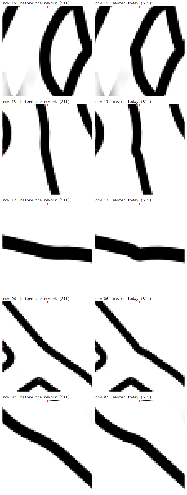

# K1179: thread geometry, a review (Levi's question, 2026-11-04)

A read-only review for the coordinator (claude session 7301c55b). It draws on the committed code at HEAD (`7474d09b`), the design docs named in each section, the K1040 S1i sheet and `git log`. Nothing was built, run or timed for it. Numbers marked "inferred" are derived here, not measured. Filed as K1179 on 2026-11-04; the crops are in `.claude/probes/K1179/review/img/`.

## 1. For Levi

**Recommendation.** Keep the threads and the physics exactly as they are. Replace the many separately drawn junction pieces with one rule that defines a junction's whole outline every frame, from the thread centres: each arm's edge, plus a round between neighbouring arms, drawn pixel by pixel. Then take crossing gaps from that same rule (at each pixel, which thread is on top) instead of from a separate calculation.

**Why.** Almost every junction and gap bug in the record comes from two habits, not from the physics:
- **Pieces.** One outline is assembled from about seven kinds of pieces (strips, wedges, rims, fans, discs, stadiums and cover strips) that only roughly meet. The notches, spurs, ticks and pale stars live in those seams.
- **Fresh choices.** Every small choice is made again from scratch each frame, so anything that crosses a threshold in motion pops. Each fix for a pop (a "guard") costs a little shape somewhere, and K1163 is one of those.

When the border look moved to one rule (K1040's reference, "form B"), its seams went away. What is left there is the cost on the phone and a few guards like K1163's.

**Your idea, part by part.**
- **(a) Keep threads and physics: yes.** Nothing in the record is their fault.
- **(b) A dedicated system for smooth junction edges: yes.** This is the core of the fix, and half of it already exists: form B for the border look, and the G4 plan for the fill look.
- **(c) A soft-body skin: no, as a simulation.**
  - It would lag behind a fast tug and drift in width.
  - It would need rebuilding whenever arms appear or merge.
  - It would cost about as much as the physics again.
  - The same knot could draw differently depending on how it got there.

  The instinct behind (c) is right, though. The useful kernel is a skin bound to the skeleton *without* the physics. The edges are a fixed recipe of the centres each frame. The few on/off decisions (which arms a round joins, which crossing a gap belongs to) are held steady and faded instead of flipped.

**K1163.** The cusp is real at rows 15, 13/14, 12 and 06: see `.claude/probes/K1179/review/img/k1163_rows.png` (left: before the rework, right: today).
- **Cause.** A guard shrinks the round to almost nothing at corners whose sides start near the junction. It does this even at nearly straight corners, where a round could never visibly pop.
- **Fix.** A softer guard, scaled by how much ink a pop would really move, brings the rounds back at rows 06-14 in about one stage. Row 15 needs the rule itself changed.
- **Where it shows.** The cusp appears only in the border-look reference pictures. The game's default look draws these corners another way.

**What to try first.** One small offline test, about one stage, with no GPU. Use form B's corner rule as the fill look's junction outline on the twelve test scenes and the scripted sweeps, and check four numbers:
- no inward cusp in any round;
- no tangent break where pieces meet;
- no jump bigger than ordinary motion under a scripted tug;
- the cost per frame.

If it passes, a second stage measures the phone, and the rebuild is G4 with this rule in place of its planned soft blend.

## 2. Today's construction

The live default is the fill look (`threadLook: "fill"`, `src/ui/url_state.ts`). The border look (`tlk=border`) and its label are opt-in. The label (`lbi`) is the K868 pass, `src/render/label/label_app.ts`, which `src/app/frame_loop.ts` loads lazily.

Form B (`src/render/field/form_b.ts`) is the K1040 reference that the K1163 sheet shows. Only `src/render/field/label_b*.ts` (K1097's GPU label prototype), tests and probes use it; nothing in the app loads it.

- **Skeleton.** Physics runs in the worker (K7), and main draws a mirror fed by snapshots. Whenever the geometry revision moves, which is every frame in motion, the renderer re-derives each chain's samples (`ribbon/sampling.ts`, uploaded as SAMP). Widths, quasi-3D depth and the current crossing positions come with them.
- **Body and edges: CPU mesh, per-pixel paint.**
  - **The strip.** `RibbonMesh` (`src/render/ribbon_mesh.ts`, `extrudeRibbon`) extrudes a triangle strip per chain on every geometry change, with miter joins, a concave clamp and round joins.
  - **The edges.** They are not geometry. The section-rgb fragment shader (`ribbon/ribbon_shader.ts`; G2's `paint_glsl.ts`, with its CPU mirror `paint_math.ts`) shades fill, casing and outline from the strip's cross coordinate (`uv.y`).
  - **G3-2's SDF pass.** `ribbon/ribbon_sdf.ts` draws instanced round-cone segments. It is chosen at construction by `rp=sdf`; the strip stays the default until G3-3, after Levi's phone check.
- **Junction outline and rounds: CPU mesh, per-pixel colour.**
  - **The rebuild.** `Joinery.rebuildFillets` (`ribbon/joinery.ts`, about 2,400 lines) rebuilds every junction on every geometry change. For each pair of neighbouring arms it builds:
    - wedge flanks that hug each arm's curved edge, out to `armReach`;
    - a rim through the corner (`ribbon/rim_curve.ts`), a quadratic that meets the flank tips with a tangent break (G0 only);
    - fans (`TriFanMesh`) in two layers, picked by a top/bottom vote;
    - discs at tips and joints (1.06h), tip stadiums (`tip_stadium.ts`) and K81's cover strips.
  - **Colour.** `junction_field.ts` paints per pixel from per-arm material strips (`arm_strip.ts`, K4), and `junction_routes.ts` adds K81's route bands.
  - **Corner style.** K830's `cornerRoundShare` (`corner_share.ts`) is fixed when the scene is built.
- **Crossing gaps: CPU solve, per-pixel mask.**
  - **The solve.** `CrossingGaps.computeGapSlot` (`ribbon/crossing_gaps.ts`, about 1,350 lines) re-solves every crossing on every geometry change. It finds the under thread's arc window, the over thread's polyline (at most 65 points, stride up to 3), the protect intervals, the junction clearance floors, and the self and twin splits.
  - **The table.** Each crossing is one row of the gap table (`gap_mask.ts`): 25 texels a row, referencing SAMP since G3-1. Each vertex lists up to 4 slots (`GAP_SLOTS`), and there are about 480 slots at gs 18.
  - **The shader.** For each listed slot, the fragment shader finds the nearest point on the over polyline (chunk circles cull the search) and hides the casing inside the margin.
- **State between frames.** Physics carries all of it: positions, sliding crossing positions and friction. The renderer keeps only three things:
  - caches keyed on revisions (`arm_strip.ts`'s `lastRevs`);
  - K169's web-fade clock;
  - the slot ids assigned at build.

  No geometric choice is remembered. The `prev*` variables in `crossing_gaps.ts` are locals of one solve.
- **Discrete choices made again every frame.**
  - **Joinery.** Wedges wider than `FILLET_MAX_WEDGE` (2.6 rad) are skipped (K857's borders across junctions). There is also the corner fallback, the two-layer vote, `armReach`'s min and max against the nearest gap, the 0.15 arm skip and `coverCap`.
  - **Gaps.** Which 4 slots a vertex lists, the window ends, the protect intervals, the far-branch gate and the per-slot stride (K573). There is no per-pixel winner (K42).
- **The exception: form B.** The border look's reference is built the other way. It is a float64 pure function of the frame.
  - **Corners.** They are closed form: `solveCorner` gives a rolling-ball round of radius r = the rule's r × w, where w = margin × steep × cap × root gates.
  - **Evaluation.** `evalPoint` evaluates the outline per point.
  - **Choices.** They are smoothed by gates and fades, not remembered.

## 3. The record

Commit counts are messages that name the ID (`git log --grep`), excluding ledger-only commits.

| Root cause | Items | What broke | What fixed it, or not | Size |
|---|---|---|---|---|
| **A. Seams between separately built pieces** (fill look) | K4, K81, K830, K846-K859, K1139 S3b; the joinery classes in G3G4 section 1.2 | Colour and shape seams where fans, discs, strips, wedges and rims meet: V-notches, flank and tucked-tip spurs, pale stars and the x160 merge-core tick. Borders ran across junctions because wedges wider than 2.6 rad were skipped (K857). Every new junction feature must be ported to each piece: K81 then, K1139 S3b now. | K4: fans read per-arm strips. K81: route bands, cover strips and K169's fade. K854/K857/K859: outline fixes, and the rim was pulled out into `rim_curve.ts`. Still open: the G0 rim (a biarc is next) and the x160 tick. | K4: 12. K81: 22. K830: 5. K1139: 13 so far. K846-K859: five items in two days. |
| **B. Choices made again every frame, popping in motion** (both looks) | K868, K992, K922, K1000, K1040 S1-S1i, K1114, K1163 | Corners, folds and caps jump when the knot crosses a threshold, and each gate that stopped a pop cost shape somewhere at rest. | K868's field renderer: dropped. K992's continuous corner rules: dropped after one day. K1040 put corners in closed form with gates and fades, over seven stages: S1b holes and fades, S1c hand-off pops, S1d corner, S1e bends, S1f reach, S1g gates, S1i restore. K1000's folds still pop (they close at K1040 S4b). K1163 is the latest gate's cost. | K868: 101. K992: 34. K922: 8. K1000: 12. K1040: 103. K1114: 15. |
| **C. Parameterization** | arc-length wrap on closed chains | Sampling broke four times ("arc-wrap 4th bite", `a37f4f51`). | Point fixes. | small |
| **D. Gaps as a second CPU model of the same geometry** | P3.21, P3.40, G1, K572, K573, K320 with K550, K42, K43 | Giant gaps at oblique crossings (the offset-curve margin). Wedge-slash shapes (three erase mechanisms). G1's GPU cost, 2.2 times master's. G3-1's gap search took 57 ms a frame on the phone. Silhouette cycles need a per-pixel winner. A tail riding its host depends on draw order. | P3.21: arc-length margins. P3.40: erase caps, 5 to 13 lanes. G1: per-pixel masks, cutting `update()` from 12.0 to 5.7 ms. K573: a per-slot stride, cutting the search from 60.7 to 19.3 ms. K320's split was reverted (K550, six commits). K42 and K43 are still open. | K573: 12. K320: 31. 223 commit messages mention gaps. |
| **E. The phone** | K1097 (K1040 S3) | The GPU label reached 0 DEFECT on the 12 scenes but missed the phone's 2 ms by 5-20 times. | S3c-S3f3 tried drawing levers, and all of them failed their census. S3f4 is finding the bound. | 61 commits name K1097. |

K1040 was planned as S1-S8 in about 15 h (F7). S1 took eight sub-stages and S3 nine, while S2 and S4-S8 have not started. That is 129 commits, 103 of them code, in eight days.

**Inherent, or the split?** Some of it is inherent. The problem is to round the outline of a moving union of ribbons while arms appear, swing and merge, and to keep it continuous in motion, exact at rest and cheap on a phone. There is no off-the-shelf answer: F4 measured smooth-min off-look, JFA too slow on the phone, and a CPU incremental build too slow.

Most of the churn, though, comes from how today's construction splits the problem:
1. **Pieces.** One outline is made of about seven kinds of pieces, so smoothness is a property of seams that no single function owns (A).
2. **Fresh choices.** Every choice is made fresh each frame, so any threshold the knot crosses in motion pops. Each gate that fixes a pop trades away some shape (B, and K1163).
3. **A second model for gaps.** Gaps come from a second model of the same geometry, which has to steer around the junction pieces (clearance floors, protect intervals). The two disagree where they meet, and the per-pixel search is the phone's cost (D).
4. **Two looks.** The fill and border looks each have their own junction machinery, so no fix is shared.

The one place built as a single definition is form B: one closed-form outline, with no seams and no state. It reached 0 DEFECT. What remains there is the gates' cost (K1163) and the phone's GPU time (K1097), not seams.

## 4. K1163

The crop is `.claude/probes/K1179/review/img/k1163_rows.png`: left is before the rework (S1f), right is master today (S1i). The red ticks mark V, and each panel spans ±110 px at z4. The three-panel crops per row (S1f, today, restored) are `.claude/probes/K1179/review/img/rowNN_v.png`.

| Row | Site | θ | r: S1f to today | What it looks like |
|---|---|---|---|---|
| 15 | muse_hash j124 375-376 | 2.218 (127°) | 1.967h to 0.078h | The clearest: the round is gone, and the edge turns 53° at a sharp inward point. |
| 13, 14 | j49 151-152 (user_tw42.lightpaper; g41_user_tw42) | 3.025 (173°) | 2.000h to 0.037h | A notch in the edge at V. |
| 12 | g41_user_tw64 j12 36-37 | 3.012 (173°) | 2.000h to 0.028h | A notch in the upper edge and a bump in the lower. |
| 06 | muse_default_tw j57 172-173 | 2.820 (162°) | 4.000h to 0.678h | A tight kink. |
| 07-11 | muse_hash, muse_default_tw | 2.56-2.95 | 4h to 1.25-1.72h | Still rounded; these read smooth. |

At every site the ink moves at most 1 device px from S1f's edge (dpr 2), changing 24-76 px per site. S1i's restore left these rows as they were: today equals restored.

**Cause.** The cusp comes from S1g F2's root gate in form B's `solveCorner` (`src/render/field/form_b.ts`, around line 1004, `rootBand: 0.5`).
- **What the gate does.** It is a fourth factor of w: ss(d / 0.5h), on each foot's distance d from its arm's root.
- **Why it exists.** Once a foot reaches its root, the window test nulls the corner, full round and all. On gate699 (θ 2.0), r used to step from 2.000h to 0 in one sweep step, and the ink by a full level. With the gate, those steps are 0.030 and 0.125.
- **Where it misfires.** The band is the same at every angle. At near-straight corners the feet sit within half a width of a root even at rest; 129 of the 155 corners the gate moved are like this. So the round shrinks to almost nothing with no null nearby.
- **The cusp.** With no round, the two arms' slightly convex edges meet at an inward point: the concave butt cusp. The ink barely moves, but the tangent breaks (7° at rows 12-14, 53° at row 15), and that is what the eye reads.
- **The check.** `rootBand: 0` returns every site to S1f exactly (`.claude/probes/K1040/s1/out/s1i/sites_rb0.txt`), and brings back gate699's 2.000 step.

**Does "softer" remove it?** For rows 06-14 it does, inside today's approach, in about one stage. Row 15 needs more.
- **What the gate measures.** What a null removes is the round's tip, which sits r·(1/sin(θ/2) − 1) inside V. That is 0.188r at θ 2.0 but only 0.0017r at θ 3.02, so a near-straight corner's round can vanish without a visible step. The gate measures foot distance, a stand-in, rather than the ink it protects.
- **The softer guard.** Scale the band by the tip factor: band(θ) = 0.5h · min(1, t(θ)/t(2.0)), with t(θ) = 1/sin(θ/2) − 1.
  - At gate699's angle this is today's band, so gate699's 0.030 and 0.125 hold by construction.
  - The tip moves at about 1.1 times the root's speed at every angle.
  - The bands come out at 0.005h for rows 12-14, 0.01-0.12h for rows 06-11 and 0.31h for row 15.
- **Rows 06-14 (inferred from the r ratios, not measured).** Their feet sit about 0.03-0.2h from their roots, several new bands away, so they get S1f's r back and the cusp goes.
- **Row 15.** Its foot sits about 0.06h from its root at a 127° corner, which is exactly the case the gate exists for, so its r would come back only to about 0.2h. Fixing this class needs a change to the definition: let the foot run past the root onto the neighbouring arm, so that no null exists to guard against.
- **The stage.** Change one factor in `solveCorner`. Re-run `.claude/probes/K1040/s1/gate699_s1g.ts`, the gates census, the s1i sheet and the tee and ring sweeps. Pass criteria:
  - rows 06-14 at 0 px from S1f at rest;
  - gate699, tee and ring steps no worse than 0.125, 0.148 and 0.174;
  - no new label pops.
- **The card.** The cusp exists only in form B. The live fill look draws these corners with joinery's fans and is unaffected, and the card should say so.

## 5. Levi's idea, part by part

### (a) Keep the threads and physics

- **Fixes:** nothing in section 3 is caused by them, so nothing there needs changing. All the breakage in the record happens downstream of the samples. The renderer already gets what it needs through one seam, K7's snapshot: sample positions, widths, depth, crossing positions and junction arms.
- **Costs:** none, but it sets the geometry layer's job. Physics owns the events that make geometry hard:
  - arms swinging far from rest under a tug;
  - material sliding through crossings, with gaps migrating along;
  - junction arms appearing, merging, or being cut by the reveal.

  Whatever draws the edges must take these as inputs every frame and stay continuous through them.
- **Simplest variant:** today's, with the snapshot as the only input to geometry, so the drawing can be rebuilt without touching physics.

### (b) A dedicated system for smooth, rounded junction edges

- **Fixes:**
  - A: with one definition of the outline, each round meets its arms' edges with G1 by construction, and nothing has to be ported piece by piece.
  - Part of D: gaps can come from the same definition, hiding a casing wherever a deeper thread's body covers it. That replaces a second CPU solve which has to steer around the junction pieces.
  - The two-looks split: the fill look fills the outline that the border look strokes.
- **Half of it exists.** Form B is this system for the border look: one closed-form outline per frame (arm edges plus rolling-ball rounds), and the reference that reached 0 DEFECT. G4 plans the fill look's version (section 6).
- **Costs:**
  - B moves inside it: any definition with windows and nulls needs gates, and gates trade shape (K1163).
  - The phone's GPU time is the open risk: K1097's label pass missed 2 ms by 5-20 times.
  - It is a rebuild. The fans, discs, wedges, rims and cover strips retire only after K81, K127, K169, K268, K290 and K1139 are carried over (G4's port list).
- **Simplest variant:** form B's corner model as the one outline for both looks. For the fill look only the junction domains are new (the ribbons stay), drawn by one per-pixel pass over each junction's disk.

### (c) That geometry as a soft-body skin bound to the thread centres

Read as a simulation: edge points (two per sample, or per particle) with rest offsets from the skeleton, springs to their anchors and to each other, integrated every frame.

- **What it fixes:** the symptom of B. A skin moves continuously, so it cannot pop.
- **What it breaks or costs:**
  - **Arms swinging far from rest.** A round's size and its feet depend on the angle between the arms, which changes by tens of degrees under a tug, so the rest offsets are wrong at the new angle. A soft skin lags, and its edge trails the thread exactly where gaps and rounds are judged. A stiff skin is just the per-frame function with extra steps.
  - **Material sliding through crossings, and migrating gaps.** Material slides along the thread through each crossing, but a gap belongs to where the threads cross now, and a round to where the arms meet now. A skin bound to material would carry the old gap away with it. Keeping it right means re-binding it continuously, which makes it a function of the current frame again.
  - **Junction topology.** Arms appear, merge, fuse and are cut by the reveal. A skin mesh has fixed connectivity, so every change is a remesh, and a remesh pops (B again).
  - **Width drift.** Integrated offsets drift from the true half-width, but casing width is a hard rule: gaps, pass separation and the look are all measured in widths.
  - **CPU.** Physics is about 12 ms a frame mid-drag on desktop, 40% of it collision. A skin with its own constraints and self-collision adds a solve over a similar number of points, and the phone is slower. It would also run in the worker and add to every snapshot.
  - **History.** A skin's shape depends on how the knot got where it is. Today one state draws one picture, which the probes' same-state checks rely on, and one link builds one maze on every device (K108).
- **Simplest variant that keeps the benefit: skinning without simulation.**
  - The skin is a fixed recipe of the skeleton, evaluated each frame. Form B already is one.
  - The binding (which arms a round joins, which crossing a gap belongs to, the corner style, the layer order) is made at rest or kept with hysteresis.
  - When a binding must change, the change fades over a short time instead of snapping, as K169's web fade and K1040 F3's fades already do. This is route 3 in section 6.
- **Verdict:** as a simulation, no; its kernel, yes.

## 6. Alternatives

1. **Today, cleaned up (fill look).** Keep the strips, fans, discs, wedges and rims, and fix the known defects one at a time: a biarc rim for G1 at the flank tips, hysteresis on the layer vote and the reach clamps, cover strips folded into the fan shader, and the x160 tick.
   - For: it is the cheapest route, and the least risky step by step.
   - Against: it fixes neither A nor D as a class, and every new junction feature still has to be ported to each piece (K1139 S3b is doing that now). For the same approach in the border look, K1040's "Why" concluded that patching does not converge.
2. **A per-pixel outline from the skeleton each frame (SDF).** The body is the distance to each arm's centre line minus its half-width (G3-2's round-cone segments). At a junction, an n-ary union of its arms adds rounds between neighbours. Three parts:
   - **Rounds by smooth union (smooth-min).** It is cheap and continuous, but F4 measured it off-look for these rounds. Its blend constant would have to range over 0.01-20.9 px; the apex lands up to 3.35 px off and the band edge up to 8.30 px off. Even a per-corner constant leaves 0.62 px. Smooth-min is not the definition; at most it is a fallback blend.
   - **Rounds by exact rolling-ball corners** (form B's `solveCorner`). Each corner is solved on the CPU every frame and evaluated per pixel. F5 measured 0.3-2.7 ms on desktop, almost all of it the candidate search. The rounds are exact, G1 by construction, and continuous wherever the gates are.
   - **Gaps from the over-thread's distance.** A pixel's casing hides when a deeper thread's body covers it within the margin. That gives K42 its per-pixel winner and replaces `computeGapSlot`'s windows and clearance floors. The cost is finding the nearby threads, which is what cost the phone 57 ms in G3-1 (K572). It needs the slot or tile lists that G3 already has.
3. **Parameters bound at rest, evaluated per frame (hysteresis).** Choices are fixed at rest, or held with enter and exit thresholds and a minimum hold, while the shape is recomputed every frame.
   - For: it fixes B directly and cheaply, and works with route 1, route 2 or form B.
   - Against: the picture depends on history unless the bindings travel with the state. A held binding can also go stale at a far swing, so it needs a validity test that forces a rebind, with a fade.
4. **(c) as a simulation.** See section 5.

**What `docs/design/G3G4_sdf_geometry.md` covers.** It plans route 2 for the fill look, in two parts:
- **G3:** one SAMP texture of samples, instanced round-cone SDF ribbons, and gap slots that reference SAMP.
- **G4:** a per-cluster joint SDF, with octagon domains, a hard union of the pieces plus a smooth-min web between bracketing pieces only, an exact hand-off to the ribbons and an edge-aware colour blend. It ports K81, K127, K169, K345, K76, K268 and K290. Then it deletes the fans, `TriFanMesh`, the discs, wedges and votes, the arm strips, the cover strips and the junction-field program.

**How far it got.** G3-0, G3-1 and G3-2 have landed. G3-3, which deletes the strip, waits on Levi's phone look and a render-sync measurement. G3-4, G3-5 and all of G4 have not started, and K9 follows the border look. Gaps stay on G1's slot model, re-packed.

**How it relates.** G4 is the fill-look half of Levi's (b), already designed and costed. Its one weak point is the smooth-min web, which F4 later measured off-look. Form B is the other half.

**Recommendation.** Take route 2 with route 3's bindings:
- one outline definition for both looks: arm edges plus form B's rolling-ball rounds;
- drawn per pixel in G4's junction domains;
- any choice that still pops held by hysteresis, or faded;
- gaps moved onto the same depth-and-distance definition once the junctions are done.

Not (c). Land K1163's softer guard now: it is one stage, independent of the rest. Before anything else, run the spike in section 7. It tests the two things that could sink this direction: whether form B's corners, tuned for a stroked band, make a good fill outline everywhere, and what they cost per frame.

## 7. The first test

**The spike:** form B's corners as the fill outline, run offline in Node with no GPU. It is one stage (about 2 h), plus a second on the phone only if the first passes.

- **Input:**
  - the 12 K868 scenes (`.claude/probes/K868/scenes`);
  - the gate699, tee and ring sweeps, plus a synthetic sweep of one arm through 60° about its junction in 0.005h steps;
  - the K868 S3a drag recordings, for real motion: `def_drag`, `muse_drag` and their `_flow` pair. The S3a scripts read them from `.claude/probes/S3a/seq13/`, copied to the main checkout on 2026-11-04 (untracked, desktop only); the scripts are still only in `.claude/worktrees/k868-s3a/.claude/probes/S3a/` (K1176).
- **Build:** at each junction, the union of the arms' bodies (half-width h) and form B's rounds, using K1163's softer root band.
  - Sample each junction's boundary in float64: 100 points per round, every 0.01h along the edges.
  - Make z4 crops against today's joinery fill on the same frozen states, for the look. (Claude makes these after the spike, K1178 Run I: the scenes' `.master.png` frames are border-look captures of c4e4e67e, 2026-10-26, not today's fill.)
- **Pass criteria:**
  1. **No concave cusp.**
     - From one foot to the other, plus 0.1h on each side, the boundary's signed curvature keeps the round's sign at every sample (κ ≥ −0.01/h).
     - No round falls below 0.25h where the rule gives at least 1h, except inside a null's band. Those exceptions are counted and listed.
  2. **G1 where pieces meet.** At every foot, and at every hand-off between a junction domain and its ribbons, the tangent jumps by at most 1° and the position by at most 0.05 device px. No exceptions on the 12 scenes.
  3. **Stable under the scripted tug.**
     - Per frame, no boundary point moves more than its skeleton's motion plus 1 device px (dpr 2).
     - The largest ink step per coarse sweep step stays within the sweeps' ordinary rate: 0.148 on tee, 0.174 on ring, and 0.125 on gate699, including corners appearing or vanishing.
  4. **Cost per frame.**
     - **CPU:** the corner solve's p95 through the recordings is at most 0.75 ms at defaults on the desktop, measured under the perf lock. That is the phone's 2 ms divided by a desktop-to-phone ratio of about 2.7 (G1's `update()`: 12.0 ms on desktop against 32 ms on the phone; different links, so rough).
     - **GPU (stage 2):** build the per-pixel junction pass and hold it to G4-1's bar on the phone: at most 4 ms at 2x for the whole fabric. This is the larger risk, given K1097's 5-20 times miss.

If criteria 1-3 cannot hold at the same time, or the CPU solve is over budget, the direction needs rethinking before any rebuild.
