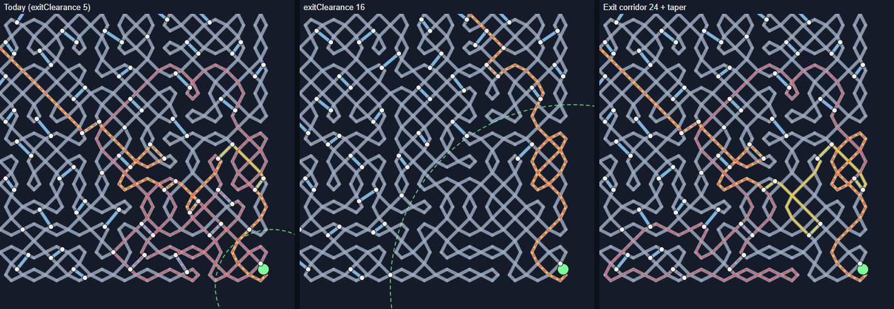
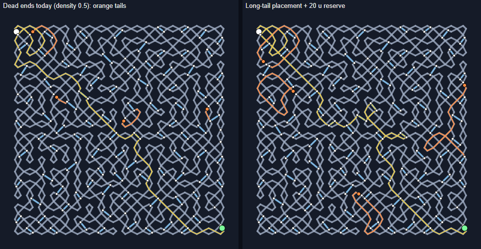
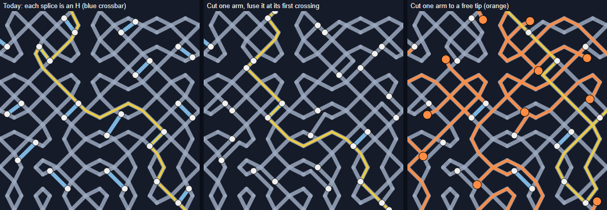

# K74: good maze design, measured

Status: research, measurements and a plan for Levi (2026-10-13). Nothing
in `src/` changes. Every prototype lives in the probe harness
(`.claude/probes/K74/`; section 8 says how to rerun it). Levi's three
requests are quoted in section 9.

Units: the maze plan's doubled lattice units, **u**. One grid cell is
2 u, so a gs-18 board is 36 u wide and its start-to-exit diagonal is
48 u. "V1" is today's design (codec v3's defaults, which is DAILY_V1),
measured on the real dailies #1-#120. Option comparisons use dailies
#1-#80, the same seeds for every option.

## Conclusions

**What makes a maze good (section 1).** Five points recur across the
sources. Only the first two rest on human data.

1. **Length and turns cost time.** Human solving time grows with route
   length and with the number of turns, even at fixed length.
2. **The right way should sometimes lead away from the goal.** Solvers
   drift toward the exit at junctions. Mazes whose correct move heads
   away from the goal are harder; this is measured on children and
   monkeys, and maze writers advise it (Pullen).
3. **Few routes, loops kept off the solution.** In a braided maze,
   difficulty comes from loops that send you round without a wrong-way
   signal. Many near-equal routes make it easy.
4. **Long blind alleys, not stubs.** "Pipe cleaner" dead ends are pruned
   at a glance. Long ones cost a solver time before they show themselves.
5. **Near misses and a measured finish.** Paths that pass the goal
   without reaching it lure solvers. Fisher's mazes, as Plotkin describes
   them, end with a calm home stretch after the hard branch. Many open ways
   in make the finish trivial.

**How ours measures (V1, 120 dailies).**

- **Junctions are uniform.** A maze has 196 junctions and 103
  independent loops. Junction density is flat across the board: 1.16-1.19
  per 10 u of thread at every distance from the exit beyond the 5 u
  clearance disc. Nothing thins out near the finish, so Levi's
  impression is right: the exit region is as connected as the middle.
- **Heading for the exit mostly works.** At 71-74% of the decisions on
  the optimal route, the arm that points at the exit (or ends nearest
  it) is an optimal move.
  - A player who always takes that arm and never turns back finishes
    28-44% of mazes within 4x the optimal length.
  - With memory and backtracking, a greedy player walks 1.96x the
    optimal route (median; 1.26-5.62 from p10 to p90). It gets within
    1.5x on 27% of dailies.
  - It is not trivial, but it is by far the cheapest strategy: random
    exploration walks about 20x.
- **The route rarely turns away.** It moves away from the exit for 16% of
  its length, and the largest retreat in the median maze is 2.3 u, about
  one cell. Once it comes within 12 u of the exit, it leaves again in
  only 6% of mazes.
- **Wrong turns are cheap.** A wrong arm at a route decision costs 6.7 u
  (about three cells) in the median, because the braid offers many
  near-equal ways round.
- **Dead ends are stubs.** With `deadEnds` on (0.25), a maze has 2.1 dead
  ends. The junction-free tail before each tip is 4.5 u in the median
  (2.2-10.2); 11% reach 10 u and 1% reach 20 u. The dead thread itself
  is long, but splices land on it every few units, so only the last stub
  is dead.
- **H's are a quarter of every solve.** A maze has 93 splices, each a
  1.2-2.0 u bridge (shorter than a cell). 5 of the 19 taps in an optimal
  solve (28%) are bridge crossings, spread evenly along the route. 26% of
  a greedy player's moves are bridges.

**The existing knobs (Levi: "lmk").** Yes, two of them already move the
maze toward good design, a third removes the H's, and the rest do little
(section 3.1).

| Knob | Setting | Effect vs V1 |
|---|---|---|
| `exitClearance` | 12 or 16 (V1: 5) | The strongest anti-greedy lever there is. Greedy walk 2.59x / 3.48x (V1 1.96x); heading walk 4.19x / 5.09x (2.87x). The cost: the finish becomes an empty zone reached by one long junction-free run of 15-20 u, so the last third of the route has about 3 (at 12) or 2 (at 16) decisions instead of 5. |
| `junctionSpacing` | 2.5 or 3 (V1: 2) | Fewer, costlier decisions: 140 / 108 junctions, wrong turns cost 9.8 / 14.2 u, heading walk 3.51x / 4.34x, route 92 / 105 u. |
| `fourWayFraction` | 0.9 or 1 (V1: 0.12) | Removes the H's: choice junctions become 4-way merges, leaving 38 / 8 splices and 1-2 bridge taps per solve. 129 / 94 junctions; difficulty about unchanged. |
| `branchDensity` | any of 0.2-0.6 | Inert at spacing 2 (K62): the same maze. It matters only where the spacing floor stops binding (at spacing 1.5, or with `fourWayFraction` near 1). |
| `entranceClearance` | 6 or 12 | Moves the first decision from 6 u in to 10 / 18 u in. No effect on difficulty. |
| `deadEnds`, `deadEndDensity` | on, 0.25-1.0 | 2-8 dead ends, still 3-4 u stubs. No effect on difficulty. |

The best existing-knob settings are `exitClearance 16` alone (greedy
3.48x, heading 5.09x, 171 junctions, route 96 u), or with
`junctionSpacing 2.5` (3.02x / 5.29x, 123 junctions, route 104 u).

**New mechanisms, prototyped and measured (section 4).** Every option
below slept in all 16 sampled mazes in a Node physics run, except where
noted.

- **Long dead ends (Levi's ask): cut where the tail is longest, and keep
  junctions off it.**
  - Choosing the dead-end cut so its free flank runs along the strand's
    longest junction-free stretch raises the median tail from 4.5 u to
    20.2 u, with no junction removed.
  - Placing dead ends before the choice junctions and reserving 20 u of
    each tail makes 98% of tails at least 20 u (median 22.8 u). The
    packing re-places most of the displaced junctions; the maze ends up
    about 2 junctions lighter per dead end.
  - Levi's junction-removal pass, used alone with today's cut
    placement, reaches only a 13.1 u median (36% at 20 u or more). The
    cut often sits next to a junction that carries reachability and
    cannot be removed.
- **H shapes: cut an arm only if the cut arm is fused, not left loose.**
  - Levi's free-tip version turns the braid into a tree: loops drop from
    103 to 28, and the maze gains 74 short dead ends of 6.9 u. Each tip
    can sit only 0.4 u from the corner it was cut from, and 5 of 16
    sampled mazes never fell asleep (they thrash at up to 1.3 u per
    substep).
  - Fusing the cut arm into its first crossing instead (the corner-trim
    machinery that ships today) removes 69 of 93 H's (bridge taps per
    solve 5 -> 1). It keeps every junction, loop and decision, and sleeps
    like V1.
  - `fourWayFraction 1` gets much of the same with no code.
  - A gameplay-only compound move (one tap crosses a bridge and runs on)
    removes the extra step without touching generation.
- **The finish: a junction-free exit thread (corridor) plus a gentler
  taper keeps decisions near the exit, but none of them lead in.**
  - Corridor 24 u plus taper: greedy 2.79x, heading 3.96x.
  - Once within 10 u of the exit, the greedy player walks 3x the
    distance it still needs (V1 1.66x). With `exitClearance` it is 1.0x,
    because nothing is left to decide there.
  - With the "away" flank and `exitClearance 12`: 3.80x / 6.34x, the
    strongest combination measured.
- **A greedy-trap search.** Re-test the finished plan with the two naive
  walkers, and delete the choice junction nearest the exit on the path
  that let them through, up to 12 times.
  - It lifts the greedy walk to 2.85x and cuts the share of dailies a
    greedy player solves within 1.5x from 25% to 7%.
  - The maze is otherwise V1 (195 junctions, the same route and
    decisions). It costs about 6 ms per trial, about 60 ms per maze in
    the median.

**Recommended first step.**

1. **Now, with no code:** give DAILY_V2 (K46) `exitClearance 12`.
   - Greedy walk 2.59x, heading 4.19x, the route 10% longer, 12 fewer
     junctions, physics unchanged.
   - 16 is the stronger and emptier finish; 12 keeps about three
     decisions in the last third.
2. **First code change:** long-tail dead ends with a 20 u reserve (F),
   as two appended params that default to today's behavior. They are
   small and isolated, Levi asked for them, and there is no downside.
3. **Then:** a fix for the H's, once Levi has picked the look (decision 4
   below); and the corridor, taper and search package for the daily.

## Decisions for Levi

1. **The target.** Should a player who heads straight for the exit
   usually go wrong somewhere?
   - Proposed bar: a greedy walk of at least 2.5x the optimal (median),
     at most 15% of dailies solvable greedily within 1.5x, and at most
     about 20% solvable by never turning back.
   - Today: 1.96x, 25% and 30-41%.
   - The sources also warn against frustration ("Frustration is not
     challenge"), so the bar should be a band, not a maximum.
2. **The finish.** Which one?
   - (a) an **empty zone** (`exitClearance` 12-16, existing knob): one
     way in, a calm home stretch, Fisher's pacing;
   - (b) a **trap zone** (corridor plus taper, new code): near-exit
     junctions stay, but none lead in;
   - (c) both (C3 / P3).
3. **Ship the zero-code step now?** That is `exitClearance 12` (or 16)
   in DAILY_V2. Should ordinary links' defaults change too (codec v4),
   or only the daily?
4. **H shapes.** Which fix?
   - **H1**, the fused arm cut: generation, junction count unchanged.
     Each H reads as two T's.
   - **H3**, `fourWayFraction` 0.9-1: no code, but an X-junction look and
     fewer junctions.
   - **H6**, the compound move: gameplay only. It keeps the H look but
     removes the extra tap.
   - **H6 now and H1 later.**

   The free-tip version (H2) is not recommended: it makes stub dead ends
   and breaks sleep.
5. **Dead ends.** Adopt long-tail placement with a 20 u reserve (or 30)?
   Should DAILY_V2 turn dead ends on by default, and at which density (2,
   4 or 8 per maze), or keep them for twist days only?
6. **The greedy-trap search (D).** Is it acceptable for the generator to
   tune each maze against two naive players? If yes, should it run at
   load (it needs exact, engine-independent arithmetic) or offline into a
   table?
7. **K46's bands.** Raise the greedy band from 1.1x (95% of seeds pass,
   so it does nothing) to "far-end 1.5x and heading 2x" (59% pass, 1.7
   candidates per day)?

## 1. What the research says

Sources, with the strength of each:
- Walter Pullen's *Think Labyrinth* (the algorithm, glossary and "Maze
  Psychology" pages).
- Jamis Buck's *Mazes for Programmers* (the official excerpts and code)
  and his blog.
- The papers: McClendon (Bridges 2001), Kim's dissertation and Kim,
  Grove, Wurster and Crawfis (FDG 2019), Ashlock, Lee and McGuinness
  (IEEE TCIAIG 2011), Bellot et al. (Information Sciences 2021) and
  Gabrovšek (2019).
- Human studies: Crowe et al. 2000, Zhao and Marquez 2013, Beran et al.
  2015, Semizer et al. 2024 and 2025, and Kryven et al. 2024.
- Adrian Fisher's practice, as seen in Andrew Plotkin's reviews of his
  corn mazes, and Jeff Saward's maze typology.

Fisher's own books, Robert Abbott's essays and the book-only Buck
chapters (dead-end counts, braiding) could not be reached. Claims that
rest on them are marked unverified or left out.

### 1.1 Measured findings

- **Route length and turns drive human solving time.** Crowe et al.,
  *J. Cogn. Neurosci.* 12(5), 2000: "RT increased as a function of key
  parameters of the maze, namely the length of the main path…"; "The
  dependence of RT on the number of turns was present even when the
  path length was fixed". Semizer et al. (*J. Vision* 2024) find
  fixations track path length (r .93) and turns (r .92) in unbranched
  mazes.
- **Moving away from the goal is hard.** Beran et al. 2015 (*J. Comp.
  Psychol.* 129(2), PMC4437918) showed the whole maze, it appears. For the
  26 children analysed, maze type had a large effect (F(3,72) = 37.74),
  and younger children dropped most on "Away" mazes, where the correct
  move heads away from the goal. On the monkeys: "the need to move away
  from the goal added another (seemingly larger) performance cost".
- **How people solve a fully visible maze.** Zhao and Marquez 2013
  (arXiv:1307.5713; 25 participants, 60 mazes) found people alternate
  between exploring with their eyes and guided movement. Exploring took
  15-25% of solving time. The drivers they observed (no statistics):
  "total path length, numbers of turns, and the presence in the maze of
  long 'blind alleys' that, if entered, required time (back tracking) to
  return to the correct path."
- **Under fog, people plan a few steps ahead.** Kryven et al. 2024
  (*PLOS Comput. Biol.*): choices were "best explained by planners with a
  limited horizon". This matters for the fog-of-war mode.
- **Solver agents.** Gabrovšek 2019 uses a heuristic depth-first agent
  that prefers neighbours closer to the end, which is our greedy walker.
  Mazes grown from the end were "3 to 7 times higher" in agent steps,
  except for that goal-seeking agent.
- **Formal difficulty measures are unvalidated.**
  - McClendon's difficulty, δ(M) = log[γ(T) · Π(γ(B_i) + 1)], assumes
    "that no maze contains a loop" and is backed only by worked examples.
  - Bellot et al. find McClendon's complexity "almost equivalent to the
    length of the solution". Of decision-cell and turn counts they say:
    "None of them was conclusive."
  - The one human-validated solver metric found (a 2025 *Entertainment
    Computing* paper: BFS search size against solve time, r ≈ 0.68) could
    not be read beyond its abstract.
- **Texture vocabulary** (Pullen, astrolog.org/labyrnth/algrithm.htm):
  - *River* is "the relative density of dead ends and junctions": low
    river means many short dead ends, high river few long ones.
  - *Braid*: "A "braid" Maze means one without any dead ends." A partial
    braid has both loops and dead ends.
  - Pullen's dead-end shares by algorithm: recursive backtracker 10%,
    Kruskal's and Prim's 30%, growing tree up to 49%.
  - Visual pruning by dead-end filling "won't do much in heavily braid
    Mazes", an algorithmic fact.

### 1.2 Designers' judgment (opinion, no data)

- **Pullen, "Making Difficult Mazes"** (astrolog.org/labyrnth/psych.htm):
  - "Psychologically, people tend to make choices at junctions that lead
    toward the exit. Having passages that seem to lead away from the exit
    be the right path can make a Maze harder." Hairpins at junctions also
    help, "because people tend to be reluctant to "undo" what they just
    did."
  - "The more solutions there are to a Maze, the easier it is. The
    hardest Mazes usually have a single solution, or all the solutions
    are close to each other."
  - "Just have the loops not on the solution path, so they make the Maze
    harder instead of easier to solve."
  - "Mazes with blind alleys that deviate a long distance from the
    solution path make a Maze harder", while "a Maze with only small hair
    like dead ends like a pipe cleaner is easy to navigate".
  - "Having the solution path go within sight of but not past a landmark
    is a good way to make many people take the wrong path." With the exit
    as the landmark, this is the near miss.
  - "Just because a Maze is difficult doesn't necessarily mean it's a
    good Maze."
- **Fisher, as Plotkin saw his corn mazes** (eblong.com/zarf/essays):
  - "The left-hand and right-hand rules don't work. The goal is inside,
    and there's a bridge from there to the exit."
  - The layout is loops in series: "there's a major branch point, the
    branches come back together, there's another branch point".
  - The finish is a calm home stretch after the hard branch: "It provides
    a nice sense of closure -- you reach the end without a sense of
    anticlimax."
  - Plotkin's own rules: "Frustration is not challenge", and "Don't make
    a maze which is a homogenous, undifferentiated experience of
    lostness."
- **Saward** on hedge mazes: "islands within islands … can be developed
  into very intricate mazes with few dead ends that are nonetheless
  extremely difficult to solve." A braid can be hard.
- **Kim's dissertation (2019)** names *forward dead ends*, "a dead-end
  tree that heads towards the ending point. It provides the illusion that
  the dead-end tree is leading to the ending point."
- **Buck** on weave mazes, whose passages cross over and under like our
  threads. Long passages with few junctions make them look impressive,
  but "Solving such a maze is not really very difficult."
- **Ashlock et al.** found that maximizing route length alone yields
  "winding paths that do not branch", which are trivial.
- **Against backward solving.** By Loyd's account, his "Back from the
  Klondike" (1898) was built to defeat working back from the goal. James
  Propp, quoting Thomas T. Thomas, notes that placemat designers put long
  dead ends near the start, because "All the possible traps and dead ends
  in a maze are designed for the pencil moving forward."

### 1.3 Braided versus perfect

The two kinds fail differently, by Pullen's account:
- **Perfect mazes** have one route. Dead ends signal a mistake at once,
  but a solver can prune them by eye.
- **Braided mazes** give no wrong-way signal. A mistake costs a detour,
  and nothing can be pruned.

A braid turns easy when its routes are many and near-equal, or when its
loops sit on the solution. Ours has 103 loops spread evenly, with no
bottleneck between the start and exit tails, which is the "homogenous"
shape Plotkin warns against. Fisher's loops-in-series layout needs
bottlenecks: runs every solution must pass through. Our threads cross
the whole board, so a mid-maze bottleneck would need many strands cut.
The exit corridor and `exitClearance` are a bottleneck at the finish.

### 1.4 What we take from it (our inference)

| Principle | Measure used here | V1 |
|---|---|---|
| Heading for the exit should mislead (Pullen; Beran) | Greedy walkers' distance over optimal; how often the naive pick is right; memoryless solves | 1.96x / 2.87x; 71-74%; 28-44% |
| Few, distinct routes (Pullen) | Share of thread on a route within 10% of optimal; wrong-turn penalty | 14%; 6.7 u |
| Some right moves lead away (Pullen; Beran) | Share of route moving away; largest retreat | 16%; 2.3 u |
| Long blind alleys (Pullen; Zhao) | Junction-free dead-end tail | 4.5 u |
| Near misses at the goal (Pullen) | Junctions within 12 u of the exit that are over 3x farther on foot | 9 of 20 |
| A calm finish after the hard choice (Fisher) | Route after its last decision; decisions per third | 7.2 u; 5.6 / 6.7 / 5.4 |
| Choices are the content (Bellot; Kim) | Decisions and bits of choice on the route | 18; 18.2 bits |

No source validates any measure on braided mazes. The daily already
logs moves, backtracking and solve time, so regressing those on these
measures would give a validated difficulty score (a ledger idea).

## 2. Our maze, and how it was measured

### 2.1 What the generator builds

The threads are the corridors. At gs 18 the lattice knot has about 9
large closed strands (6-13). The plan (`core/maze_plan.ts`) turns them
into a maze in four steps:

1. **Corners.** The strand edge nearest each anchor is cut. One flank
   keeps the off-board tail (the start or exit dot). The other is trimmed
   back to its first crossing, which is fused into a 3-way junction (the
   "corner trim"). That junction sits 0.6 u from the exit but 15-65 u
   away on foot: a built-in near miss.
2. **Backbone.** About 8 spanning splices (rarely 4-way merges) connect
   every strand. They prefer sites outside the clearance discs, but use
   one inside if nothing else connects. Besides the corner trim, which is
   always inside, 0.7 (at `exitClearance` 12) to 2.2 (at 20) backbone
   junctions per maze land inside the disc.
3. **Choice junctions.** About 85 more splices and 9 four-way merges,
   placed farthest-first under the `junctionSpacing` floor. The floor,
   not `branchDensity`, decides how many fit (K62).
4. **Dead ends** (`deadEnds` on): at most one cut per strand, placed
   farthest-first. The shorter flank is trimmed and the other keeps a
   free tip.

A splice is an **H**: a 1.2-2.0 u bridge between two near-parallel
threads, with a junction on each. The walk graph (`core/walk_graph.ts`)
has a vertex per junction and end, and an edge per thread run between
them. A tap moves the player one run. V1 has 196 junctions and about
300 runs (median 3.8 u, p90 12.8 u). Its 1,690 u of thread hold an
84 u optimal route: 5% of the thread (Pullen's "elitism").

### 2.2 The harness

`.claude/probes/K74/` builds every design with `main.ts`'s own calls
(lattice, plan, apply, cuts, walk graph). It starts from the DAILY_V1
days and puts a recipe's overrides on top, so every recipe is measured
on the same seeds. Prototypes are:
- a hooked copy of `buildMazePlan` (`proto_plan_src.ts`). With no
  options it builds the identical plan and walk graph for all 150
  designs checked, shapes and dead ends included;
- graph passes that run after the cuts (`proto_hcut.ts`,
  `proto_search.ts`).

All lengths are the walk graph's deterministic lattice lengths. Physics
checks run the real `ParticleSystem` in Node at 1/120 s substeps, judged
by the K63 sleep gate on 0.1 s frames.

The walkers all start at the entrance. "x" is the distance walked over
the optimal route.

| Walker | Plays like |
|---|---|
| far-end greedy | At each junction, takes the unused run whose far end is nearest the exit (the full-length pulses show where each run goes). Backtracks when every run is used. Gabrovšek's heuristic depth-first agent. |
| heading greedy | The same, but judges a run only by the direction of its first 3 u (one and a half cells). |
| memoryless | Takes the run that points most at the exit, never the one it came by, with no memory. Gives up at 4x. "Solves" means it reaches the exit. |
| random | A depth-first explorer that picks unused runs at random (mean of 24 runs per maze). |
| backward | The greedy walkers run from the exit to the start: how easily the maze traces from the finish. |

Other measures:
- **decisions**: junctions on the optimal route. **Bits** add log2 of
  the onward options at each.
- **penalty** of a wrong arm at a decision: its run plus the shortest
  rest from its far end, minus the optimal rest.
- **agreement**: the share of route decisions where the greedy pick is
  an optimal move.
- **exit corridor**: the route length after its last decision.
- **near miss**: a junction within 12 u of the exit whose walking
  distance to it is more than 3x the straight distance.
- **dead-end tail**: the junction-free run from a free tip to its first
  junction.

## 3. Measurements

### 3.1 The existing knobs

Each maze knob in the panel, one at a time, then the best combinations:

| Setting | Junctions | Route u | Decisions (last third) | Wrong turn u | Greedy far-end | Greedy heading | Memoryless solves (heading / far-end) | Exit corridor u |
|---|---|---|---|---|---|---|---|---|
| **V1** | 196 | 84.3 | 18 (5.2) | 6.7 | 1.96 | 2.87 | 28% / 44% | 7.2 |
| junctionSpacing 1.5 | 254 | 74.3 | 19 (5.7) | 4.8 | 1.79 | 2.09 | 40% / 47% | 7.4 |
| junctionSpacing 2.5 | 140 | 92.0 | 15 (4.8) | 9.8 | 2.21 | 3.51 | 25% / 44% | 7.6 |
| junctionSpacing 3 | 108 | 105.3 | 14 (4.5) | 14.2 | 2.10 | 4.34 | 24% / 54% | 7.7 |
| junctionSpacing 4 | 74 | 128.6 | 12 (4.0) | 19.1 | 2.15 | 5.04 | 16% / 46% | 10.5 |
| exitClearance 0 | 197 | 84.1 | 18 (5.6) | 5.9 | 2.02 | 3.17 | 25% / 38% | 5.2 |
| exitClearance 8 | 193 | 86.3 | 18 (4.5) | 7.0 | 2.19 | 3.77 | 35% / 42% | 10.5 |
| exitClearance 12 | 184 | 92.3 | 17 (2.9) | 6.8 | 2.59 | 4.19 | 24% / 42% | 15.4 |
| exitClearance 16 | 171 | 95.8 | 15 (1.8) | 7.3 | 3.48 | 5.09 | 19% / 31% | 19.7 |
| exitClearance 20 | 155 | 101.8 | 15 (1.3) | 6.7 | 3.21 | 5.94 | 14% / 36% | 19.7 |
| entranceClearance 6 | 195 | 85.5 | 18 (5.7) | 6.2 | 1.83 | 3.01 | 31% / 42% | 7.6 |
| entranceClearance 12 | 183 | 91.2 | 16 (6.1) | 6.8 | 1.91 | 2.97 | 30% / 45% | 7.6 |
| branchDensity 0.1 | 178 | 85.4 | 16 (5.4) | 7.9 | 1.98 | 2.90 | 26% / 40% | 7.5 |
| branchDensity 0.2 or 0.6 | identical to V1 | | | | | | | |
| fourWayFraction 0 | 188 | 86.7 | 18 (5.5) | 7.6 | 2.03 | 3.06 | 28% / 42% | 7.6 |
| fourWayFraction 0.4-0.7 | identical to V1 | | | | | | | |
| fourWayFraction 0.9 | 129 | 85.9 | 15 (4.3) | 8.7 | 1.75 | 2.88 | 35% / 50% | 7.6 |
| fourWayFraction 1 | 94 | 88.4 | 13 (3.5) | 8.7 | 2.04 | 2.18 | 41% / 45% | 7.4 |
| deadEnds 0.25 / 0.5 / 1.0 | 199-204 | 84 | 18 | 5.9-6.7 | 1.96-1.98 | 2.5-2.9 | 30-35% / 40-43% | 7.4-7.6 |
| exitClearance 16 + entranceClearance 6 | 170 | 98.9 | 15 (1.9) | 7.6 | 3.30 | 5.16 | 14% / 33% | 19.7 |
| junctionSpacing 2.5 + exitClearance 12 | 131 | 102.2 | 15 (2.8) | 9.6 | 2.44 | 4.96 | 23% / 42% | 16.2 |
| junctionSpacing 2.5 + exitClearance 16 | 123 | 104.3 | 13 (1.9) | 10.7 | 3.02 | 5.29 | 24% / 34% | 19.7 |
| junctionSpacing 3 + exitClearance 12 | 102 | 117.3 | 13 (2.8) | 14.6 | 2.98 | 5.81 | 19% / 35% | 16.2 |

Reading it:

- **`exitClearance` is the anti-greedy lever.**
  - At 12-16 it raises both greedy walks by 30-80% and cuts the
    memoryless solves.
  - It works the way Levi guessed. With no junctions in a 6-8 cell disc,
    every thread near the exit passes by without connecting, and the
    only way in is one long run that starts well outside the disc.
  - The cost: the last 15-20 u of the route are that one run, with no
    decisions, and the maze has 12-25 fewer junctions in total.
- **`junctionSpacing` trades many cheap decisions for fewer costly
  ones.**
  - At 2.5-3 each wrong turn costs 1.5-3x more, and the heading walker
    struggles more (3.5-4.3x).
  - The far-end walker hardly notices (2.1-2.2x): with longer runs, its
    one-run lookahead sees farther.
  - Below 2 (at 1.5), everything gets easier.
- **`fourWayFraction` near 1 is the existing H fix** (section 4.8).
- **The rest barely move difficulty:** `branchDensity`, `fourWayFraction`
  below 0.8, `entranceClearance` and `deadEnds`. `entranceClearance`
  only pushes the first decision deeper in.

### 3.2 Junctions near the exit

Junctions per 10 u of thread, by straight distance from the exit:

| Distance u | 0-4 | 4-8 | 8-12 | 12-16 | 16-20 | 20-24 | 24-32 | 32-40 | 40-56 |
|---|---|---|---|---|---|---|---|---|---|
| V1 | 0.55 | 1.18 | 1.17 | 1.18 | 1.17 | 1.16 | 1.16 | 1.17 | 1.18 |
| V1, by distance from the entrance | 1.14 | 1.19 | 1.15 | 1.14 | 1.18 | 1.18 | 1.16 | 1.17 | 1.08 |
| exitClearance 16 | 0.46 | 0.06 | 0.07 | 0.58 | 1.17 | 1.17 | 1.17 | 1.17 | 1.18 |
| taper (R 16, K 1) | 0.44 | 0.68 | 0.81 | 1.04 | 1.17 | 1.16 | 1.16 | 1.17 | 1.18 |
| taper (R 24, K 2) | 0.42 | 0.33 | 0.46 | 0.53 | 0.71 | 1.02 | 1.16 | 1.17 | 1.18 |
| exit corridor 24 | 0.55 | 1.11 | 1.18 | 1.16 | 1.17 | 1.16 | 1.16 | 1.17 | 1.18 |

V1 is flat from either end. The farthest-first packing fills the board
evenly, and the 5 u exit clearance only empties the corner (the 2.5 u
entrance clearance barely shows). About 20 junctions lie within
12 u of the exit. In the median maze their walking distance to the exit
is 2.9x the straight one, and 9 of them are near misses.

Across V1's 120 dailies, the far-end greedy walk is longer when:
- the exit corridor is longer (Spearman rho 0.31);
- the near-exit junctions are farther on foot (0.27 for the ratio, 0.25
  for the near-miss count).

It is shorter, weakly, when more junctions lie near the exit (-0.09 to
-0.12). The shape of the optimal route itself (how much it moves away
from the exit) does not predict it (0.00).

So heading for the exit fails when threads near the exit do not
connect to it, not when the optimal route is twisty.

### 3.3 Heading for the exit (naive players)

| | Far-end greedy | Heading greedy | Memoryless solves (heading / far-end) | Random | Backward (far-end / heading) | Naive pick right |
|---|---|---|---|---|---|---|
| V1 median | 1.96x | 2.87x | 28% / 44% | 19.9x | 1.87x / 3.06x | 71-74% of decisions |
| V1 p10-p90 | 1.26-5.62 | 1.61-20.1 | | | | |
| within 1.1x / 1.5x | 5% / 27% | 1% / 8% | | | | |

Once within 10 u of the exit, the far-end walker walks 1.66x the
distance it still needed: the endgame is not free, but most of its
waste comes earlier. Tracing back from the exit is about as hard as
going forward (1.87x), so the finish is no shortcut for a solver tracing
the maze on paper.

### 3.4 The solution path

| | V1 median (p10-p90) |
|---|---|
| Optimal route | 84.3 u (72.9-95.0), 1.75x the straight line, 19 taps |
| Decisions on it | 18 (12-23): 2.1 per 10 u, 5.7 / 6.7 / 5.2 by third, 18.2 bits |
| First decision; exit corridor | 5.5 u in; 7.2 u (2.2-12.6) from the end |
| Moving away from the exit | 16% of its length; largest retreat 2.3 u |
| Leaves again after coming within 12 u | 6% of mazes |
| Wrong-turn penalty | 6.7 u median; 4% cost under 1 u; 12% cost 20 u or more |
| Near-optimal thread | 14% of all thread lies on some route within 10% of optimal |
| Turn-back points | 17 local maxima of distance from the start (Ashlock's culs-de-sac) |

### 3.5 Dead ends

| Setting | Dead ends | Tail u, median (p10-p90) | Tails 10 u or more | 20 u or more | Greedy enters (per solve) |
|---|---|---|---|---|---|
| deadEnds 0.25 | 2.1 | 4.5 (2.2-10.2) | 11% | 1% | 0.10 |
| deadEnds 0.5 | 4.3 | 3.9 (2.2-9.6) | 8% | 1% | 0.24 |
| deadEnds 1.0 | 8.0 | 3.1 (2.2-8.8) | 7% | 0% | 0.36 |

The dead thread is long: a former loop, and 1,690 u of thread over about
9 strands is 190 u each on average. But the choice splices packed onto
it leave only the last 2-5 u before its tip free of junctions. Dead ends
are per strand, so their count tops out near the strand count (about 8
at gs 18). In a 103-loop braid two stubs change nothing about difficulty
(greedy 1.96x with or without them).

### 3.6 H shapes (Levi's second item)

| | V1 |
|---|---|
| Splices (H's) per maze | 93 (about 8 carry reachability, 85 are choices) |
| Bridge length | 1.2-1.3 u: 34%; 1.3-1.5: 13%; 1.5-1.8: 36%; 1.8-2.0: 16%; none longer (a cell is 2 u) |
| Bridge crossings per optimal solve | 5 of 19 taps (28%), spread 1.7 / 2.1 / 1.6 over the route's thirds |
| Taps shorter than 2.5 u | 7 of 19 |
| Greedy player's moves that are bridges | 26% |
| Ladder segments (two H's on the same pair of threads, under 2.5 u apart) | 8 per maze |

The H's do not cluster where they hurt most. They are everywhere, at a
uniform density, and a quarter of every solve is the "awkward extra
short step".

## 4. Options

Every row is 80 dailies, paired with V1 (1.96x / 2.84x greedy on these
80). "Sleep" is a Node physics run of 16 of those mazes, judged by the
K63 gate; V1 is 16 of 16 asleep at sim 5.0 s.

| Option | Junctions | Route u | Decisions (last third) | Greedy far-end / heading | Greedy within 1.5x | Memoryless solves | Other | Sleep |
|---|---|---|---|---|---|---|---|---|
| V1 | 196 | 84.1 | 18 (5.4) | 1.96 / 2.84 | 25% | 30% / 41% | | 16/16 |
| A1 exitClearance 12 | 184 | 92.3 | 17 (2.9) | 2.59 / 4.19 | 19% | 24% / 42% | exit corridor 15.4 u | 16/16 |
| A2 exitClearance 16 | 171 | 95.8 | 15 (1.8) | 3.48 / 5.09 | 15% | 19% / 31% | exit corridor 19.7 u | 16/16 |
| A3 junctionSpacing 2.5 + exitClearance 16 | 123 | 104.3 | 13 (1.9) | 3.02 / 5.29 | 20% | 24% / 34% | wrong turn 10.7 u | 16/16 |
| B taper (R 16, K 1) | 187 | 87.8 | 17 (4.2) | 2.17 / 3.65 | 21% | 29% / 42% | graded density | 16/16 |
| C1 exit corridor 24 | 196 | 92.0 | 18 (3.1) | 2.29 / 4.11 | 20% | 16% / 31% | near misses 9 -> 18 | 16/16 |
| C2 corridor 24 + taper | 187 | 92.7 | 17 (2.6) | 2.79 / 3.96 | 23% | 17% / 35% | endgame 2.98x | 16/16 |
| C3 corridor 24, away flank, exitClearance 12 | 183 | 92.1 | 16 (2.1) | 3.80 / 6.34 | 9% | 17% / 25% | | 16/16 |
| D greedy-trap search | 195 | 84.9 | 18 (5.2) | 2.85 / 3.78 | 7% | 21% / 23% | about 6 ms per trial | 16/16 |
| F long dead ends (0.5, reserve 20) | 193 | 84.4 | 18 (5.3) | 1.90 / 2.66 | 25% | 35% / 42% | tails 22.4 u | 16/16 |
| H1 H-cut, fused | 196 | 86.5 | 18 (5.5) | 1.84 / 2.31 | 34% | 36% / 47% | bridge taps 5 -> 1 | 16/16 |
| H2 H-cut, free tips (Levi's version) | 122 | 119.8 | 18 (6.3) | 5.17 / 4.93 | 5% | 4% / 7% | 74 dead ends of 6.9 u | 11/16 |
| H3 fourWayFraction 1 | 94 | 88.4 | 13 (3.5) | 2.04 / 2.18 | 28% | 41% / 45% | bridge taps 1 | 16/16 |
| P1 = C2 + F + H1 | 183 | 93.0 | 17 (2.5) | 2.51 / 4.37 | 26% | 17% / 38% | tails 23.1 u, bridge taps 1 | 16/16 |
| P2 = C2 + F + D | 181 | 92.3 | 16 (2.5) | 2.89 / 4.85 | 16% | 11% / 28% | tails 22.6 u | 16/16 |
| P3 = A1 + C1 (away flank) + F + H1 | 180 | 93.5 | 16 (2.1) | 2.92 / 4.17 | 21% | 16% / 35% | tails 23.1 u, bridge taps 1 | 16/16 |

### 4.1 A: new values for the existing knobs

- **Mechanism:** none new. Use `exitClearance` 12-16 as the daily's value,
  optionally with `junctionSpacing` 2.5.
- **Effect:** the largest anti-greedy gain measured; A2 multiplies both
  greedy walks by 1.8. The finish becomes a junction-free zone with one
  way in, which is Fisher's calm home stretch.
- **Risks:** the endgame loses its decisions (1.8-2.9 in the last third,
  against 5.4), so the last 15-20 u are a walk, not a choice. There are
  fewer junctions overall. Physics is unchanged.
- **Cost:** none. It ships as a DAILY_V2 override. Ordinary links keep
  v3's defaults unless Levi wants new ones (codec v4).

### 4.2 B: exit taper

- **Mechanism:** the choice-junction spacing floor grows toward the exit,
  as spacing x (1 + K x max(0, 1 - d / R)). It is a gradient instead of
  a disc.
- **Effect:** density falls smoothly over the last R u (0.44 / 0.68 /
  0.81 / 1.04 per 10 u at R 16, K 1). Alone it is mild (greedy 2.17x /
  3.65x); with the corridor it makes C2.
- **Risks:** none beyond fewer junctions near the exit. It is plan-only.
- **Cost:** one function in `pickFarthest`'s floor, with no change in
  generation time. Two appended codec params (radius and strength), both
  defaulting to 0.

### 4.3 C: exit corridor (and exit flank)

- **Mechanism:**
  - For its first L u, the exit's own thread carries no choice junction,
    no 4-way and no dead-end merge. The backbone may still use it when
    nothing else connects.
  - Variant, the "away flank": the exit cut keeps the flank that wanders
    farther from the exit within those L u.
- **Effect:**
  - The threads near the exit keep their junctions, but none connects to
    the exit thread nearby. Near misses within 12 u double (9 -> 18).
  - Once within 10 u, the far-end greedy walker walks 2.5-3x what it
    still needed (V1 1.66x; `exitClearance` 1.0x).
  - So the endgame keeps its decisions, but they mislead the direct
    approach: Pullen's "within sight of but not past".
  - C2 (with the taper): greedy 2.79x / 3.96x. C3 (away flank and
    `exitClearance 12`): 3.80x / 6.34x, the strongest combination
    measured, for a 9% longer route.
- **Risks:** the exit thread is a long junction-free run. At 36 u or more
  it starts to read as a second, unmarked tail. Physics: C2 and C3 slept
  16 of 16 (one C3 maze slept at 5.8 s, a late settler).
- **Cost:** a flank walk in the plan, with no change in generation time.
  Appended params: the corridor length (default 0) and the flank rule
  (default `stub`, today's shorter-stub rule).

Daily #3's finish (bottom-right quarter of the board) under the three
treatments: the optimal route in gold, the far-end greedy player's runs
in red, the clearance disc dashed. Today the greedy player works its way
in through the junctions near the exit; with `exitClearance 16` the disc
is empty and the one way in starts outside it; with the corridor and
taper the junctions near the exit remain, but none of them reach the
exit thread.

### 4.4 D: greedy-trap search

- **Mechanism:**
  - After the plan, run the two greedy walkers on the built walk graph.
  - While either solves under its target (2.5x far-end, 3.5x heading),
    delete the choice junction nearest the exit on its final path.
  - Accept a deletion only if it improves both walkers, keeps the route
    within 15% of its original length, and creates no trap over 6x / 8x.
  - Spanning junctions are never touched, so reachability holds by
    construction.
  - It runs up to 12 rounds of up to 8 trial deletions. A trial costs
    about 6 ms (lattice, surgery, walk graph, walkers); only the plan
    itself is slow.
- **Effect:**
  - Greedy goes from 1.96x to 2.85x, and heading from 2.84x to 3.78x.
  - The easy tail is gone: 7% of dailies can be solved greedily within
    1.5x (V1 25%), and p10 rises from 1.25 to 1.59.
  - The maze is otherwise V1: 195 junctions, route 84.9 u, 18 decisions.
- **Risks:**
  - It optimizes against two specific naive players. A human using
    another heuristic is not guaranteed to suffer, and it only removes.
  - It must give the same answer in every browser. The walkers compare
    floats, so a shipped version needs exact arithmetic (squared lattice
    distances, integer dot products) or a precomputed table (K46's
    alternative).
  - Physics: 16 of 16.
- **Cost:** about 60 ms more per generation in the median on the desktop
  (434 against 375 ms in the parallel scans), at worst 12 x 8 trials or
  about 0.6 s; a phone is about 5x slower. It runs once per design. One
  appended param (on/off; targets in the code).

### 4.5 E: selection bands (K46's mechanism)

This is not a generation change. K46's draft already rerolls a day's
seed until its maze passes bands, one of which is "greedy at least
1.1x". On V1, 95% of seeds pass that band, so it changes nothing.
Measured on the 120 V1 dailies:

| Band | Seeds that pass | Candidates per day | Greedy far-end / heading (median) | Memoryless heading solves |
|---|---|---|---|---|
| none | 100% | 1.0 | 1.96 / 2.87 | 28% |
| far-end 1.5x+ | 73% | 1.4 | 2.29 / 2.90 | 24% |
| far-end 1.5x+ and heading 2x+ | 59% | 1.7 | 2.31 / 3.49 | 17% |
| far-end 1.8x+ and heading 2.5x+ | 37% | 2.7 | 3.06 / 4.07 | 16% |
| both memoryless walkers fail | 43% | 2.3 | 2.47 / 3.91 | 0% |

It is cheap and leaves the generator alone, but it only filters: the
typical day still has uniform junctions and stub dead ends. The same
exact-arithmetic rule applies.

### 4.6 F: long dead ends

| Method | Tail u, median (p10-p90) | Tails 20 u or more | Junctions vs today | Greedy |
|---|---|---|---|---|
| Today (0.25) | 4.3 (2.2-9.8) | 1% | 0 | 1.96 |
| Levi's removal pass (drop the choice junctions on the tail out to 20 u) | 13.1 (2.2-29.1) | 36% | -5 (2.6 splices dropped) | 2.18 |
| Long-tail placement, no removal | 20.2 (13.0-32.6) | 51% | 0 | 1.93 |
| Long-tail placement + removal pass to 20 u | 23.1 (14.3-33.2) | 79% | -2 | 1.93 |
| Long-tail placement, dead ends first, 20 u reserved | 22.8 (20.5-29.8) | 98% | -4 | 2.11 |
| the same, 30 u reserved | 32.2 (30.2-40.1) | 98% | -6 | 2.12 |
| the same, 20 u, density 0.5 (4.3 dead ends) | 22.4 (20.1-28.6) | 92% | -8 | 1.90 |
| the same, 20 u, density 1.0 (8 dead ends) | 20.5 (7.4-26.9) | 58% | -13 | 1.83 |

- **Mechanism (recommended form):**
  - Pick each dead-end cut by the longest junction-free stretch of its
    strand, and trim the side that leaves the free flank running along
    that stretch.
  - Place dead ends before the choice junctions, and mark the first
    `deadTail` u of each free flank as used. No choice splice, 4-way or
    other merge then lands there, and the packing re-places most of those
    junctions elsewhere (about 2 per dead end are lost).
- **Why not the removal pass alone:** today's placement often puts the
  cut right beside a junction that carries reachability (a spanning
  splice, a trim) or a merge, which the pass may not remove. So 44% of
  tails stay under 10 u, and each dropped splice takes two junctions with
  it. With long-tail placement the pass does help (79% at 20 u or more),
  but reserving first does better (98%).
- **Effect on play:** small, as the research predicts.
  - Two to four dead ends in a 100-loop braid are rarely entered (the
    greedy player enters 0.15 per solve), and they do not move the
    greedy walk.
  - In this game a junction-free dead end is a single run, so backing out
    costs one tap. Its cost is the trip and the efficiency stat, and
    above all the tracing a careful player does before committing.
  - They matter for texture, for the HUD's dead-end stat and for
    Wednesday-style twists, but not for difficulty, unless there are many
    (density 1.0: 8 per maze, entered 0.36 per solve) or they are placed
    as decoys (4.7).
- **Risks:**
  - A dead thread's free tip hangs mid-fabric as it does today (Stage
    11), now at the end of a longer free run. 16 of 16 slept.
  - At density 1.0, a few strands have no 20 u junction-free stretch, so
    their tails stay shorter.
- **Cost:** a strand walk per candidate cut, with no change in generation
  time. Appended params: the placement rule (default `spread`, today's)
  and the tail reserve (default 0).

### 4.7 G: decoy dead ends near the exit

- **Mechanism:** long-tail dead ends whose free tips must lie within R of
  the exit. A player heading for the exit is drawn down a long
  junction-free thread that stops just short: Kim's "forward dead end".
- **Effect:**
  - 58-75% of those tips sit closer to the exit than their branch point,
    and the greedy player walks into 0.26-0.28 of them per solve (other
    dead ends: 0.10-0.15).
  - But the greedy walk itself does not change (1.98-2.04x). With 100
    loops, it simply backs out and takes a neighbouring run.
  - Only 1.9 decoys fit per maze at R 14, because a strand has to pass
    close to the exit.
- **Verdict:** worth keeping as the placement rule on days with dead
  ends, not as a difficulty lever on its own.

### 4.8 H: the H shapes

| Variant | Bridges left | Bridge taps per solve | Taps under 2.5 u | Junctions | Loops | Decisions | Route u | Greedy | Dead ends | Sleep |
|---|---|---|---|---|---|---|---|---|---|---|
| V1 | 93 | 5 of 19 | 7 | 196 | 103 | 18 | 84.1 | 1.96 / 2.84 | 0 | 16/16 |
| H1 cut one arm, fuse it at its first crossing | 22 | 1 of 19 | 6 | 196 | 103 | 18 | 86.5 | 1.84 / 2.31 | 0 | 16/16 |
| H1 on half the H's | 61 | 3 of 19 | 7 | 196 | 103 | 18 | 84.8 | 1.86 / 2.66 | 0 | |
| H2 cut one arm to a free tip (Levi's version) | 18 | 1 of 19 | 4 | 122 | 28 | 18 | 119.8 | 5.17 / 4.93 | 74 (tail 6.9 u) | 11/16 |
| H2 on half the H's | 58 | 4 of 18 | 6 | 162 | 68 | 17 | 92.4 | 2.74 / 4.24 | 34 (6.9 u) | |
| H3 fourWayFraction 0.9 | 38 | 2 of 16 | 4 | 129 | 90 | 15 | 85.9 | 1.75 / 2.88 | 0 | 16/16 |
| H3 fourWayFraction 1 | 8 | 1 of 14 | 3 | 94 | 87 | 13 | 88.4 | 2.04 / 2.18 | 0 | 16/16 |
| H4 longer minimum bridge, 1.6 u | 76 | 5 of 17 | 6 | 169 | 93 | 16 | 85.5 | 1.73 / 2.99 | 0 | |
| H4 longer minimum bridge, 1.9 u | 14 | 3 of 9 | 3 | 34 | 19 | 8 | 187.5 | 1.99 / 5.22 | 0 | |
| H5 fewer splices (junctionSpacing 3) | 52 | 5 of 15 | 5 | 108 | 55 | 14 | 105.3 | 2.10 / 4.34 | 0 | |
| H6 compound move (taps only) | 93 | 0 of 13 | 2 | 196 (104 stops) | 103 | 12 | 84.1 | | 0 | n/a |

H6 is measured by contracting each bridge into one vertex. The stop
count, taps and decisions are exact. The walkers there would see each
bridge as free, so their numbers are not comparable and are left out.

**H1, fused (recommended form of Levi's idea).**
- **Mechanism:** at each H, choose one junction (B) and cut one of its
  two host arms.
  - B becomes a plain corner (host -> bridge).
  - The cut arm is trimmed back to its first crossing, which is fused
    into a 3-way junction. This is exactly the corner and dead-end trim
    machinery that ships today.
- **Topology:** the junction moves from B to that crossing.
  - Junction count, loop count and decisions are unchanged.
  - The bridge stops being a stop of its own: bridge taps per solve drop
    from 5 to 1, and ladders from 8 to 0.
- **Safeguards:** options are tried smoothest-corner first, and each must
  pass these checks:
  - same-strand splices and self-crossings are excluded;
  - no crossing on an end's run (the entrance and exit tails, a dead-end
    tail) is fused;
  - the whole walk graph stays reachable from the start. The check never
    fired on V1's H's; it fired on 4 of 80 mazes with long dead ends,
    whose open threads can strand a region.
- **Coverage:** 69 of 93 H's get cut. The rest have a junction or an end
  before any crossing on every arm.
- **Where it lives:** in `maze_apply.ts`, beside `cutStrandOpen`, as a
  new kind of trim on an applied graph.
- **Look:** an H reads as a T (the bridge into the far thread), plus a
  new T where the cut thread ends at its crossing. Over/under is lost at
  that crossing, as it is today at every trim.
- **Difficulty:** slightly easier for the naive players (1.84x / 2.31x),
  because with fewer stops each run shows more.
- **Physics:** 16 of 16 slept. They settled a little later (last motion
  at 1.2 s against 0.6 s), with 6% fewer particles.

**H2, free tips, as Levi described.**
- The cut arm keeps its material and ends in a free tip. In a braid this
  makes a different maze: 74 short dead ends (median 6.9 u, exactly the
  stubs Levi wants rid of), 28 loops instead of 103, and a 43% longer
  route.
- The tip can sit only 0.4 u from the corner it was cut from. Placing it
  farther means deleting a crossing pass, which breaks the weave's
  alternation. So it reads as still attached.
- 5 of 16 sampled mazes never slept: they thrash at up to 1.3 u per
  substep.
- The arms whose removal would disconnect the maze are skipped, but that
  is not the problem; the tips are.
- Not recommended.

**H3, `fourWayFraction` 0.9-1 (no code).**
- All choice junctions become 4-way merges of existing crossings, so the
  H's vanish except the 8 spanning splices.
- The maze keeps its braid (87-90 loops), with fewer but richer junctions
  (94-129, each with three ways on).
- Difficulty is unchanged; the heading walker even does better (2.18x).
- Generation is 15x faster (25 ms), because the splice packing is the
  plan's cost.
- Physics: 16 of 16 slept, with 18% fewer particles.
- The look changes most: X-shaped merges everywhere instead of H's.
  Every junction would also show whatever the renderer does at 4-way
  merges; on 2026-10-11 that included faint hairline dashes inside 4-way
  merge cores (`docs/history.md`). Worth a look before choosing it.
- `branchDensity` starts to matter here, because it sets how many 4-ways
  are attempted.

**H4, a longer minimum bridge.**
- Bridges are 1.2-2.0 u because they join adjacent parallel threads, and
  a bridge may not cross a thread. There is no longer bridge to choose.
- Raising the minimum just removes the shortest ones. At 1.6 u, 76
  splices remain and a solve still has 5 bridge taps. Past 1.8 u the
  maze collapses to 34 junctions.
- A longer bridge would have to cross threads with its own over/under:
  a new kind of splice.

**H5, fewer splices.** `junctionSpacing 3` halves the H's, but the share
of solve taps on bridges stays at 31%: fewer of everything, the same
pattern.

**H6, a compound move (gameplay only).**
- One tap on an arm beyond a bridge crosses the bridge and runs on. From
  A, the choices are A's other arm and B's two arms.
- Taps per solve drop from 19 to 13, short taps from 7 to 2, and
  decision stops from 18 to 12. The maze, its generation and every daily
  stay exactly as they are.
- The controller can record the two runs as two taps, so saved attempts
  and the walk-graph fingerprint stay compatible. The move counts in
  stats and share grids would shrink.
- It keeps the visual H, so it fixes the extra step, not the look.

**A 4-way collapse of short H's** (merging A and B into one point) has
H6's walk-graph effect. But it pulls two parallel threads 1.2-2.0 u
apart into a pinch the physics has never held: fusion against repulsion
along both threads. It was not prototyped physically. H3 gets real
4-ways at existing crossings instead.

### 4.9 Where branching happens

The taper (B) and the corridor (C) are two cases of one general control:
a spacing floor that varies with position. The prototype's
`pickFarthest` already takes a per-candidate floor. Other uses, not
measured:
- a calmer opening (raise the floor near the start instead of using the
  entrance-clearance disc);
- density waves for visual rhythm;
- K46's shapes (a floor that follows the silhouette's thickness).

The research adds one structural idea: Fisher's loops in series, joined
by bottlenecks. Our threads cross the whole board, so a mid-maze
bottleneck would need many cuts. That is a larger change, worth a
separate prototype if Levi likes the idea.

Recommendation: ship B and C as two plain params rather than a field,
until a third use appears.

## 5. Shipping without moving a daily or a link

The binding rule (`.claude/rules/generation.md` and `gameplay.md`): a
generation change moves every daily and every link,
`daily_link.test.ts` pins dailies #1-#3, and a saved attempt refuses a
moved walk graph.

- **Every new mechanism is an appended codec param whose default is
  today's behavior.** Codec v3 already took `entranceClearance`,
  `exitClearance` and `junctionSpacing` this way. A link that leaves the
  param out decodes the default, so no existing link or daily changes.
  The candidates, each defaulting to off:
  - `exitTaperRadius` and `exitTaperStrength` (B; 0 = none);
  - `exitCorridor` (C; 0 = none) and `exitFlank` (enum: `stub`, today's
    shorter-stub rule, and `away`);
  - `greedyTrap` (D; off), with its targets in the code;
  - `deadEndPlacement` (enum: `spread`, today's farthest-first, and
    `long`) and `deadEndTail` (F; 0 = no reserve);
  - `spliceCut` (H1; enum: `none`, `fuse`).
- **Each needs the identity proof the prototype has.** With defaults,
  the plan and walk graph must be byte-identical. The harness's
  `proto_identity.ts` checks 150 designs; in `src/`, the golden daily
  test plus a default-plan JSON test cover it. A test should also pin
  one design with each param on, so later refactors cannot move a
  published DAILY_V2 day.
- **The daily switches by its definition, not by defaults.** DAILY_V2
  (K46) sets the new params in its recipes from a future `fromDay`;
  DAILY_V1 days keep codec v3's defaults forever. Changing PARAM_DEFAULTS
  for ordinary links is a separate choice. It needs codec v4 (a default
  change is a new codec version), and old links keep v3's meaning.
- **H6 (the compound move) is gameplay, not generation.** The maze needs
  no codec param. The move counts in stats and share grids change, so it
  should start on a DAILY_V2 day boundary too, or be a player
  preference. The controller should keep logging one run per internal
  step, so K47's saved attempts still replay.
- **Checks run at load must be engine-exact.** Anything evaluated at
  load to pick or prune a maze (D, E) must give every browser the same
  answer. That means one of:
  - integer or exactly representable arithmetic. Lattice coordinates are
    multiples of 0.5, so squared distances are exact; normalized dot
    products are not;
  - deterministic tie-breaks;
  - a table computed offline (K46 section 5's alternative).

## 6. Interaction with K46 (daily variety)

- **K46's structure table predates these measurements.** Its note that
  `branchDensity` and `fourWayFraction` are inert holds only for
  `fourWayFraction` below 0.8. At 0.9-1, `fourWayFraction` becomes the H
  fix and `branchDensity` starts to matter.
- **Its greedy band (1.1x or more) does nothing:** 95% of V1 seeds pass
  it. If K46 keeps bands, "far-end 1.5x and heading 2x" (59% pass, 1.7
  candidates per day) is the measured step up. With D in the generator,
  the band can stay loose.
- **Its Wednesday "busy junctions" twist (`junctionSpacing 1.5`) makes
  every naive player's job easier:** greedy 1.79x, heading 2.09x, wrong
  turns 4.8 u. Keep it only paired with `exitClearance` 12 or more, or
  with the corridor.
- **Its "long halls" (`junctionSpacing 3`) and "side doors" (w-e) twists
  are already harder for the heading player** (5.5x and 4.5x at gs 16).
  The side doors also bring near misses at the exit (22 within 12 u).
- **Dead-end Wednesdays should use F**, or they show 3-4 stubs. **Fog
  Thursdays** pair well with C: the fog hides the exit's approach, and C
  makes that approach a real question (Kryven's limited horizon).
- **The package scales across K46's sizes and shapes.** P1 (C2 + F + H1,
  tuned per size), every one with 1 bridge tap per solve:

  | Size | Greedy far-end | Greedy heading | Dead-end tails |
  |---|---|---|---|
  | gs 14 | 2.08x -> 2.47x | 2.98x -> 3.69x | 18.5 u |
  | gs 20 | 1.80x -> 2.08x | 2.76x -> 5.53x | 25.1 u |
  | heart 22 | 2.10x -> 2.28x | 3.26x -> 4.22x | 23.1 u |
- **Order:** K74's params land first (appended and inert), then K46's
  DAILY_V2 recipes set them. One DAILY_V2 can carry both.

## 7. Side findings

- **The plan is the whole generation cost.** At gs 18, the lattice,
  surgery and walk graph take about 6 ms together, and `buildMazePlan`
  about 250 ms.
  - The choice-splice packing dominates. With `fourWayFraction 1` (no
    choice splices) the plan takes about 25 ms.
  - `pickFarthest` recomputes every candidate's distance to every placed
    point on every pick, with `Math.hypot`. Keeping a running minimum per
    candidate would make each pick about one pass.
  - That would make K46's rerolls and option D nearly free. This is
    inferred from the timing split, not profiled.
- **K62 is confirmed and refined.** `branchDensity` 0.2-0.6 and
  `fourWayFraction` 0.4-0.7 build the identical maze on all 80 days.
  `branchDensity` 0.1, and `fourWayFraction` 0 or 0.8 and above, change
  it.
- **The corner trim is already a near miss.** The exit's trim junction
  sits 0.6 u from the exit dot but 15-65 u away on foot.

## 8. Evidence and how to rerun

Everything is in `.claude/probes/K74/`. Run it from a checkout with
`node_modules`; vite-node uses a private cache.

| File | What |
|---|---|
| `lib.ts`, `metrics.ts` | The build (main.ts's calls), the walkers, the metrics |
| `scan.ts`, `mkjobs.mjs`, `run_scan.ps1` | Scans over DAILY_V1 days with recipe overrides and prototypes; `-Script phys.ts` for physics |
| `analyze.mjs` (tables `core walkers place dead h density`), `corr.mjs`, `select_bands.mjs`, `phys_summary.mjs` | Tables |
| `proto_plan_src.ts`, `proto_plan.ts` | The hooked plan copy: taper, corridor, exit flank, dead-end placement, reserve and removal, decoys, bridge-length window |
| `proto_hcut.ts`, `proto_search.ts`, `proto_combo.ts` | The H-cut pass, the greedy-trap search, combinations |
| `proto_identity.ts` | Checks that the hooked copy with no options builds the src plan (150 of 150) |
| `phys.ts` | Node physics with the K63 gate |
| `render_svg.ts`, `svg2png.mjs` | The diagrams |
| `out/` | Specs, jobs and JSONL results (below) |

The results in `out/`:
- `scan_final` (21 recipes x 80 days): the tables in sections 4 and 6;
- `scan_knobs` (the existing knobs, 2,880 designs);
- `scan_proto` (2,320);
- `scan_pkg`, `scan_pkg2`, `scan_pkg3`, `scan_fwf`, `scan_flank`;
- `phys*.jsonl`.

To rerun a scan:
1. `node mkjobs.mjs out/spec_final.json out/jobs.json`
2. `.\run_scan.ps1 -Jobs out/jobs.json -Out out/scan.jsonl`
3. `node analyze.mjs out/scan.jsonl core walkers h dead`

The generation code measured is master 303d335's. Master has since
added a circle shape; nothing measured here changed. While a scan runs
on more than two processes it holds the machine-wide perf lock, and it
drops to two processes when another agent holds the lock.

## 9. Levi's requests (verbatim)

The brief, 2026-10-12: "In general, we need to take a step back and
think about good maze design. Please do some research. One of the things
that comes to mind is that there shouldn't be too many junctions near
the finish, otherwise it's too easy to find a path through by just
moving naiively in the most direct direction to the end. After
understanding characteristics that lead to good maze design, I want you
to research and plan possible ways that we could alter our maze
formulation to achieve some of these good design characteristics.

A related consideration is our dead ends. They are less stubby, but
still too stubby in general. We should do something to ensure longer
dead end paths with no junctions--possibly with a junction-removal pass
after?"

On the existing knobs: "it looks like adjusting some of these 'Maze'
params do give maze characteristics that are probably 'better maze
design'. But lmk."

On H shapes: "In general, I notice a lot of 'H shapes' throughout the
maze, because of how we add these splices. The splices are important,
but the H shape pattern is a bit annoying to navigate through, as it
adds this awkward extra short step, and it doesn't feel very natural.
Can we explore how feasible it would be (and any other tradeoffs) to
disconnect one of the four outgoing segments from these H shapes when we
introduce a splice? This would probably have implications for maze
thread region connectability in-general, so we'd need to be careful with
how we handle this, I assume."
